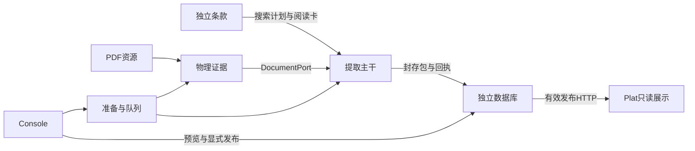

# 系统架构

## 全链路

五服务：18080文档/Console组合API；18180条款/提取；18280数据库；18081Console静态服务；8765Plat。模块与进程不是一一对应。应用组合根负责连接，不吸收各模块领域责任。

## 所有权与依赖方向

| 模块 | 拥有 | 连接 | 不应承担 |
|---|---|---|---|
| ClauseESG | 单条语义、SDK、展示组/集合索引 | 轻量合同，搜索/阅读卡 | PDF解析、模型执行、SQL |
| contracts | 两类原值、资源、证据、运行、导出DTO，通用数据语义 | 轻量函数/Pydantic | 导入执行器/前端 |
| document | 资源接入、文字/布局/OCR、IR、物理修订 | 通用搜索及证据端口 | 条款业务判断 |
| extraction | 检索、阅读、绑定、属性、目标关系、输出 | Clause SDK及Document/Model/Result端口 | 指标词库副本、SQL选源 |
| pipeline | 准备、队列、执行槽、会话、取消/恢复 | 原生服务、控制状态 | 条款含义、量值计算 |
| shared_runtime | 路径组合、进程/执行锁、调用信封、发布身份 | 基础能力 | 业务字典、理解缓存 |
| Console | 操作、状态投影、应用组合、启动器 | HTTP/SDK合同 | 页面重算科学含义 |
| database | 接收、SQL、投影、比较、选源、发布、来源保护 | 导出包及产品HTTP | 读取提取内部目录、调用模型 |
| Plat | 发布读代理、PDF解析、展示 | 数据库产品HTTP、文档散列端口 | SQL、审核和发布写入 |

细分文件责任见[模块设计](03-modules.md)。模型实现归其消费者，共享调用信封不吞并领域逻辑。

## 稳定设计决定

| 编号 | 决定 | 实际约束 |
|---|---|---|
| AD-01 | 一条为完整单位 | group只导航，单条独立加载，集合不建专用生产者 |
| AD-02 | 原值与目标关系分开 | different/未知属性不把实际值变零或删除 |
| AD-03 | 全期间捕获 | 主报告年只属资源资料，实际披露期间分别保存 |
| AD-04 | 模型选择，程序绑定 | 行列/span必须实际存在，不以模型生成值代替来源 |
| AD-05 | 有界集中阅读 | 额度归reading_policy.py，漏提先定位责任，不能四处放宽预算 |
| AD-06 | 独立交接 | ZIP/摘要/回执是接口；目录和展示CSV不是接收合同 |
| AD-07 | 比较与发布归数据库 | 提取表达实际身份和目标关系，平台不重做选源 |
| AD-08 | 当前规范一套 | 根及模块README导航到docs，历史从Git查阅 |

改变决定时更新本表及对应需求/实现。简单修复无需另建ADR；确实改变模块职责或合同才新增AD编号。

## 数据与运行边界

权威资产包括条款JSON、原PDF、不可变物理证据修订、事实和封存交接、数据库原值与发布快照。组织表、索引、预览及部分物理准备缓存可重建，仍需遵循来源保护与引用生命周期。

会话、队列、文档准备、原生阅读、交付、投影和发布分别有状态所有者。Console消费组合投影，不用一个“部分完成”掩盖多层原因。

跨模块只传资源身份、对象引用、快照、合同和HTTP。Plat不读提取目录，数据库不从目录猜包，提取通过DocumentPort取证据。

## 修复归位

词义/排除错误改条款；物理分列/来源错误改文档；通用单位改共享语义；对象先后改文档排序；重复补读/预算改阅读策略；排队/取消改编排；选源/精度改数据库；页面层级改前端。

先追“资源→证据→选择→绑定→关系→接收→产品”，找到首个偏离点，再修改该责任，不能在下游掩盖上游错误。
