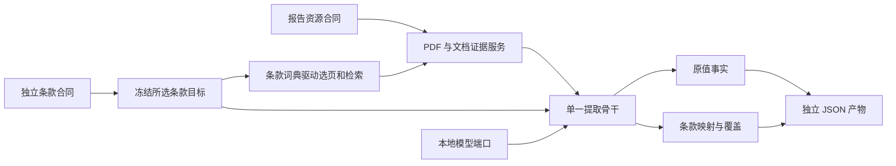

# 独立条款、数据合同与报告资源

本文件说明 2026-10-29 这一轮的当前模块接口。逐项审计与实际验证见仓库根目录《模块化重构与逐条核验报告.md》。原升级规划保留为需求依据，不再作为旧运行入口说明。

## 所有权

| 模块 | 权威内容 | 不能代替的内容 |
|---|---|---|
| `esg_clauses` + `standard/` | 每条的语义、类别、词典、范围、单位预期、阅读规则和目标证据 | 报告实际陈述和事实准入格式 |
| `data_kinds` + `pipeline_contracts` | 定量原值、定性原文、来源绑定、可扩展身份和元数据 | 某个 ESRS 条款的词义 |
| `esg_reports` | 一个 PDF 的编号、企业、发表年份、行业、散列和元数据修订 | 某条数值实际覆盖的子公司、基地或期间 |
| 文档服务 | PDF、文字层/OCR、IR、物理对象与证据读取 | 标准包目录、指标集合和条款业务解释 |
| 提取骨干 | 检索→读取→绑定→映射→覆盖→保存 | 条款专用字典、包版本或数据库表结构 |
| 编排服务 | PDF 准备、冻结输入、统一队列、取消与当前状态 | 模型语义、事实值、发布决定 |



## 条款格式

唯一源：`ExtractESG/standard/<组>/<原编号>/clause.json`。例如 `E1-5/E1-5_01/clause.json`。原编号的前导零保留。

- `group.json` 只有组号、名称、成员列表；不决定检索或读取。
- `_catalog.json` 是可重建索引，不是第二份科学定义。
- `selections.json` 只是 ID 列表：16、32、38、34、55 条集合均无专用执行路线。
- 单条拥有 `data_kind`、`definition`、`exclusions`、`value`、`output_scopes`、`retrieval`、`reading`、`evidence`、`acceptance`、`relationships`。
- 标签、词典、排除、规则、范围等任何合同内容变化都会改变 `clause_digest`。
- `readiness` 是技术可选状态，不能冒充真实提取验收或业务批准。

查询和编辑：

| API（提取服务 18180） | 含义 |
|---|---|
| `GET /api/clause-groups` | 展示分组 |
| `GET /api/clauses` | 原子条款索引 |
| `GET /api/clauses/{key}` | 一条完整合同 |
| `PUT /api/clauses/{key}` | 创建或修改完整合同；已有条款带 `expected_digest` |
| `GET /api/clause-selections` | 命名选择集合 |
| `POST /api/targets/freeze` | 冻结实际所选条款，无模型调用 |

## 两份数据合同

规范源文件：`quantitative.py` 和 `qualitative.py`，均在 `contracts/src/esg_targeted/data_kinds/`。

| 合同 | 原值必需项 | 可选项 |
|---|---|---|
| 定量 | 非空 `value_raw` | 数字解析、比较符、上下界、单位、扩展资料 |
| 定性 | 非空 `statement_raw` | 扩展资料、原文上下文 |

`SourceFact` 再要求文档身份及可回读证据。事实值的类别判别位于 `value.kind`：定量为 `quantitative`，定性为 `assertion`。

未知属性归入 `extensions`。可选数字元数据解析失败时保留原值，原提交元数据放入扩展资料；不会把无效数字变成零。定性值不接收定量专属字段。找不到证据不能生成“未披露”陈述。

身份字段允许 `stated / inherited / not_stated / not_read / conflict`，支持任意补充维度。条款固定轴是目标条件，不能复制成报告实际口径。资源企业与发表年份不能冒充测量主体与测量期间。

原值事实只记录来源与解析质量；条款专用阅读拒绝、口径差异和确认结果放进 `ClauseMapping`。不符合目标的已绑定原值仍保留。

## 文档、模型与产物端口

提取骨干只依赖 `DocumentPort / ModelPort / ArtifactPort`。HTTP 文档端口只传 IR ID、对象 ID、检索意图和证据帧：

- `GET /api/evidence/{ir_run_id}`
- `POST /api/evidence/{ir_run_id}/search`
- `POST /api/evidence/{ir_run_id}/read`

条款的 `retrieval.source_priority` 声明表格/正文优先级。词典和精确标签由目标传入；脚注只作辅助检索证据。确定的年度列先由结构选定，无法确定时交给模型；模型选择来源引用，数值由接收器从原单元格或文字位置取回。

每条独立搜索与阅读，不保存或复用跨条款中立理解结果。文档服务的结构缓存不包含模型理解。模型仅使用本地 Qwen 适配器，无云端切换。

每次运行冻结条款、文档引用、预算及引擎指纹。代码或文档身份发生变化时，待执行任务拒绝静默改用新输入。原值产物在 `facts/<事实ID>.json`；`results/facts.json` 汇集事实、映射、覆盖及摘要。消费者通过 `/api/runs/{id}/facts` 或 `/api/runs/{id}/facts/{fact_id}` 读取。模型可用的来源编号按当前证据生成枚举，不能引用目标或资源元数据当作物理证据。

## 创建运行

文档服务 `POST /api/report-sessions`：

```json
{
  "input": {"kind":"pdf", "asset_id":"pdf-..."},
  "clause_keys": ["E1-5_01", "E1-1_01"],
  "name": "报告条款提取",
  "budget": {"max_model_calls":128, "max_objects_per_clause":8, "max_output_tokens":2048, "timeout_seconds":14400}
}
```

也可用 `selection:"priority32"` 代替 `clause_keys`，或将输入改为 `{"kind":"document_ir","ir_run_id":"ir-..."}`。先调用 `/api/report-sessions/preview` 可核对冻结目标；该操作不运行模型。提交时可带 `expected_target_digest`，拒绝预览后已变化的条款集合。

状态、事实和取消分别在该路径的 `/{id}`、`/{id}/facts`、`/{id}/cancel`。PDF 准备和提取工作均进入统一工作队列，避免模型阶段并行抢占。

## 报告资源与批量导入

规范是 `report-resource-1.0`。资源 ID 和完整 SHA-256 保证一份 PDF 一条身份；企业、发表年份、行业以及独立的报告覆盖年度支持筛选。字段未知就保持未知。

`GET /api/report-resources?company=...&industry=...&publication_year=2026&reporting_year=2025`。企业、行业均可按稳定代码或名称匹配。默认只列可访问的当前 PDF；`include_unavailable=true` 可核对只有元数据的记录，`asset_available` 明确区分文件是否存在。元数据更新使用 `PUT /api/report-resources/{pdf_id}` 和 `expected_revision`。

批量目录规范和模板位于 `ExtractESG/contracts/examples/report-batch/`；机器模式位于 `contracts/schemas/report-resource-batch.schema.json`。整批先校验，再复制并登记；重复提交幂等，冲突不会覆盖。

## 当前边界

旧标准 SDK、聚合包编译/版本路线、旧提取生产者、历史任务适配均已删除。旧数据字典生成脚本已退出，新事实没有转回 Core 记录。PlatESG 数据库与已有字典保留；新格式的数据库接收器尚未在本轮实现。

Console 仍使用上轮界面。本轮按要求未重建；旧标准和创建表单所用的版本接口不再是生产接口，当前使用两服务的 `/docs` 调用新链路，不能把旧表单当作本轮验收入口。

校验入口：`scripts/check_contracts.py`；结构改动后以 `--write` 更新模式与索引，再运行普通校验。导出的六份模式覆盖条款、两种值、来源事实、报告资源与批量提交。

条款仓储读写使用共同锁和原子文件替换，更新必须匹配上一摘要。必需证据声明由条款 SDK 实际核验；失败降级条款匹配，不拒收已绑定原文。

当前运行更新范围是文档及提取后端。PlatESG 源码退役入口在隔离库验证，现有发布进程未重启；新事实接收器及该进程的维护不在本轮 PDF 生产验收内。
