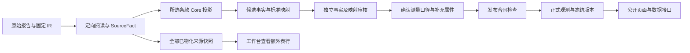

# 报告事实、补充属性与发布数据的存储链路

本页对应 2026-10-07 的实际代码。正式数据库方言为 PostgreSQL SQL；本地运行采用 PGlite。当前迁移包括 `0011_reported_properties.sql` 和 `0012_report_source_fact_snapshots.sql`，历史导入合同另有独立import-only注册表。隔离事务、接口和界面测试已完成，真实报告的提取、审核及公开属性验收仍须按业务证据逐项完成。

## 五个相互关联的对象

| 层 | 实际存储 | 含义 |
|---|---|---|
| 不可变来源 | PDF、OCR、IR 与提取 Bundle | 保留原文件、页面、对象、表格、修订和读取结果 |
| 中立来源事实 | `esg.report_source_fact_snapshots`、`esg.import_source_facts` | 所有已物化的来源事实，包括未映射的额外表行 |
| 标准候选 | `esg.esg_disclosures`、`esg.disclosure_standard_mappings` | 来源事实向明确选择的条款投影，不自动获得批准 |
| 经审核的测量口径 | `esg.measurement_contexts`、独立审核记录 | 主体、期间、边界、方法、维度、原单位及所选补充信息 |
| 正式观测与数据版本 | `esg.curated_observations`、`esg.observation_sources`、`esg.dataset_membership` | 满足发布合同的观测、冻结来源及可复现的数据集 |

来源事实、标准映射、发布状态和比较资格是不同轴。额外表行保存成功，不等于新增标准指标；映射获批，也不等于全部口径满足比较合同。



## 额外表行怎样保存

中立来源快照独立于候选表。`scripts/import-bundle.mjs` 在同一导入事务调用 `scripts/report-source-facts.mjs`，逐项保存 Bundle 中的 SourceFact。没有 Core 绑定的表行也会保存；不会为它制造 ESRS 编号、标准映射或公开观测。

快照的明确列包括报告、来源事实引用、内容摘要、文档、IR run 与修订、事实类型、原始行名、原值、原陈述、原单位、质量和证据绑定状态。`identity_raw` 保留新增属性，`physical_sources` 保留真实来源引用，`snapshot_payload` 保留完整不可变解释及附加内容。对象或混合列表可以存入原始结构，不要求为了入库先压平成字符串。

快照身份由报告、来源事实引用和不可变内容摘要确定。同一来源的另一语义解释可以产生另一快照，旧解释继续保留。`import_source_facts` 固定提取批次与快照的关联及当批 Core 绑定。重复交付幂等；后续映射或外层交付失败会回滚来源快照与批次，不留下半次导入。已有标准候选的来源冲突规则继续执行，不因中立存储放宽。

文档和 IR 必须与固定任务身份一致。跨 IR 使用只接受明确记录的证据转换；未映射来源也不能引用别的报告或无关 IR。没有物理引用的来源可以作为 `unbound` 存档，不能因此成为有原文支持的正式观测。已存入快照的 IR 即使没有任何标准候选，也受到生命周期引用保护。

工作台使用认证读取接口：

```http
GET /internal/v1/source-facts?report_ref=<报告引用>&limit=500
```

它返回来源原值、属性、质量、固定版本、批次、Core 绑定数量、`has_core / unmapped`、`has_more`及`next_cursor`。每页至多500条，工作台可继续读取后页和返回前页；累计已读数量不能当作未读总量。游标固定报告筛选与SQL时间/快照身份，使用六位微秒精度的时间及UUID键集排序，避免JavaScript毫秒转换遗漏同毫秒记录。非法或跨报告游标在查询前被拒绝，翻页失败保留当前页及原文选择。隔离SQL已验证1207条同报告快照按500/500/207完整读取、无重复遗漏；实际工作库的5条历史来源另经Chrome核查，不用伪造大量事实充填工作库。

API 另核验本地 PDF/IR 的指纹、修订及入口，核验通过才提供原文操作。旧 Bundle 不会在迁移时被暗中重新导入；后续显式交付才产生新来源快照。历史固定字典只通过已登记的import-only合同导入，不改变当前平台字典，也不能用外层选择覆盖Bundle已经冻结的范围。

## 额外属性怎样审核和公开

普通筛选和身份轴使用明确列及受约束的 `dimensions`。新测量口径只接受指标定义声明的必要、比较、固定或约束维度；主体、期间、边界等已有类型字段不能重复放进维度。未声明的额外说明进入补充属性选择，不能擅自扩大观测身份。历史冻结口径不回写。报告额外描述使用另一个字段 `reported_properties`，避免将任意说明混进观测唯一身份或比较分组。

内部候选接口提供 `available_reported_properties`。服务端从来源事实的 `identity_raw`、历史原始维度或可兼容的原始期间/边界字段读取候选，历史维度的重复项使用ordinal身份，现代identity_raw顶层字段使用ordinal=1，文本列表保留成员顺序；原值与原文依据按已保存类型解析；原始payload完整保留可能存在的单位结构。技术路径、UUID、哈希等工程字段不进入可发布选择。当前可公开类型为文本、已保存的数值文本、布尔原文和文本列表；不支持的复杂结构继续保留在来源层。

审核提交只指定来源字段、重复项序号和中文显示名：

```json
{
  "property_selections": [
    {"source_field": "identity_raw.business_segment", "ordinal": 1, "label_zh": "涉及业务"}
  ]
}
```

客户端不能提交属性原值、单位或证据。`scientific-properties.mjs` 在测量口径事务中重新解析来源，最多选择 64 项，拒绝重复或技术字段。值仍由不可变来源决定；编辑中文名不会编辑事实。当前公开补充属性的unit_raw为null：尚未实现属性级单位解析，不能借用整条指标的单位。若原属性带复杂单位结构，仍完整保存在不可变来源payload，不能把该结构未经审核直接压成公开量。

主值value_raw及原属性字符串保留原始文本；JSONB原生数字保留数值含义，但其显示转换不能保证原披露末尾零或原词法格式，不能冒充逐字原文。需要保留词法精度的新增属性应使用有证据的原值文本合同。

字段级证据与来源级说明分别表达。属性具有自己的真实引用时标记 `field`；仅有该来源整体片段时标记 `source`，页面提示需要核对属性与片段的关系。不能把一段总表证据包装成每一个属性都有独立证明。

新增字段依据使用 `bound-identity-evidence-v1`：服务器从实际阅读目录保留完整正文或列头文本、片段引用及冻结的文档/IR/修订身份。属性解析不将模型声明的 `excerpt` 直接当作完整原文；数值与英文代码不能截取自更长值，文本列表的每项都必须得到同一冻结来源的支持。来源身份缺失、修订冲突或旧式证据未满足新合同，只保留来源级说明，不改写历史公开快照。

审核后的属性存入不可变测量口径，在发布时进入 `observation_sources.source_snapshot`。公开接口读取冻结快照，后来的候选修订或审核改变不改写旧数据版本。计算观测的属性按来源保留，公开DTO表达操作数的source_role/source_label；前端已显示该来源角色，真实派生属性仍待业务样本验收；不能无依据合并不同操作数的描述。

公开列表、详情、JSON和CSV均保留所选 `reported_properties`。产品表格展示简洁摘要，来源抽屉展开中文标签、原值、单位、列表及证据范围。公开白名单移除内部选择器、审核人、本地路径和规则摘要。任意新增对象不会直接变成产品 JSON 文本块。

## 精确值与科学身份

原值始终用文本保存。例如 `001.2300`、`false`、`<0.01` 和不同报告的原单位不得因前端转换丢失。正式数值使用 PostgreSQL 精确 `numeric`；API 用十进制字符串返回，避免 JavaScript 浮点数污染数值。计数指标是否为整数由指标合同约束。单位转换保存规则及来源，不能凭标签猜测数量级。

主体、期间、边界、指标定义版本、实际/重述属性、方法及必需维度共同决定观测身份。未知方法或边界不填默认值。取水和耗水、人头和全职当量、范围单项和合计继续使用独立概念。

当前单位规则为独立不可变修订 `esg-units-1.2.0`，明确登记“亿吨二氧化碳当量”等亿数量级的能源、质量和体积别名，按精确倍率转换。旧1.1.0规则文件及已发布规范规则快照保留；规则JSON也参与服务版本握手。单位可转换不意味着指标可映射：节水量仍不等于耗水量，排放合计仍不拆成范围单项。

范围一加范围二的直接披露使用独立延伸身份，关联原 ESRS 编号；原 49 个主要条款编号保持不变。派生合计还需要已获审核的操作数、相同科学口径、精确运算、规则版本及来源血缘。直接披露和计算结果分别保留，未知范围二方法不能自动变成地点法或市场法。

## 当前实现与后续空间

- 迁移及导入：`database/migrations/0011*`、`0012*`，`import-bundle.mjs`、`report-source-facts.mjs`。
- 属性审核及冻结：`scientific-properties.mjs`、`publication.mjs`。
- HTTP 与公开白名单：`PlatESG/backend/main.py`、`service.mjs`、`public_contracts.mjs`。
- 操作界面：`ConsoleESG/src/components/ReportSourceFacts.tsx`、`ReportedPropertiesForm.tsx` 及审核页。
- 产品展示：`PlatESG/frontend/src/components/ReportedProperties.tsx`、表格与来源抽屉。

下一步新增复杂结构的公开展示，需要定义该结构的专用合同、审核和渲染组件；原始内容已经保存，不需要扩张一张无限宽表。后续规模化分析可使用冻结版本导出，另建批量分析适配器。当前尚未实施额外分析仓库，不能将这些预留空间表述为已部署能力。
