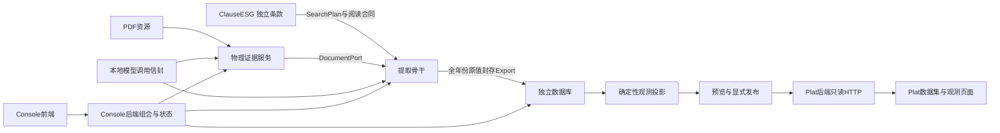

# 模块、合同与依赖

当前规范：2026-10-31。[实施与实际验证](../implementation/2026-10-31/README.md)分别报告源码、隔离测试、真实报告和部署，不将格式通过等同于内容完备。

## 模块所有权

| 模块 | 内聚职责与依赖 |
|---|---|
| ClauseESG | 一条一目录完整声明；两类值之一或非执行结构描述；只依赖轻量合同SDK，不导入执行器 |
| Extract/contracts | 两类原值、开放属性、字段证据、期间、文档端口、运行/导出合同；不导入引擎 |
| Extract/document | PDF身份、原生文字、布局、必要OCR、IR、实际物理证据；不解释条款业务 |
| Extract/extraction | 消费条款和文档端口，局部模型引用、确定性绑定、目标关系、组织和导出 |
| Extract/pipeline | 准备、队列、任务身份、取消和恢复；不维护条款词表或事实数值 |
| Extract/shared_runtime | 模型调用信封、版本身份、来源保护客户端、本机能力；不拥有业务字典 |
| Console | 报告/任务/条款/发布操作及同一后端运行状态；本地组合启动器归scripts |
| database | 接收、精确SQL、字段证据、观测/选源/发布/撤下、科研长表、来源保护事务及对外DTO |
| Plat | 经HTTP消费已发布数据；通过PDF散列端口解析来源；无SQL连接或审核写入口 |
| tools | 跨模块开发校验、SDK类型生成、结构清单、源码外冷启动；不参与业务执行 |

展示组只提供名称和成员；16/32等命名集合只是一起选择的独立ID。词典、定义、搜索、阅读、用途、证据、显示和验收声明属于单条。新需求优先扩展所属合同，骨干只增加通用能力，不写条款ID分支。条款内容变更产生新摘要，每次新任务固定当前目标与输入，便于解释其输出。

原值只有定量与定性：真实测量/陈述及物理证据是核心。期间、主体、边界、方法、分母、场址、类别均尽量读取、可缺失。目标分类不能覆盖报告细分，资源企业/主年不能替代实际主体/测量年。已知冲突改变目标关系，不抹掉原值；比较用途决定比较资格，不决定原值可见性。

模型只选择可回读行列/原文片段，程序绑定真实字串。每个已披露期间单独保留，时点/季度/财年/累计不伪装成主年年度；没有可靠期间仍可接收。没有foundation/standard双生产者，没有跨条款或跨运行理解缓存。物理OCR/IR可按PDF散列、处理计划和版本复用。

## 当前窄接口

| 服务 | 主要接口 |
|---|---|
| 条款/提取18180 | clauses、groups、selections、targets/freeze、runs及其facts/organized/exports |
| 文档/Console18080 | report-resources、report-sources/{sha}/file、evidence、report-sessions、console/monitor |
| 数据库18280 | v1/ingestion接收/回执/原值/状态、v1/projections、v1/datasets预览/发布/撤下、v1/restatements、v1/sources/lifecycle |
| Plat8765 | v2/datasets及观测/定义/来源/导出；仅有效发布可公开读取 |
| Console18081 | 当前前端及document/extraction/database同源代理 |

各层分别表达执行、搜索范围、原值可用、属性完整、比较资格、接收、投影与发布，不能合成“缺任一维度就部分执行”。会话和全局运行窗共用后端状态。跨服务传ID、摘要、DTO与封存内容，不传服务器目录，不从生产者目录推断文件。

当前值条款1.3、目录4.0、结构描述1.0、SourceFact2.0、FactBundle2.2、组织1.1、export1.1、receipt1.0。旧字典、旧包/任务读取、旧SQL/worker和冻结兼容接口已删除；不接管旧数据库。新产品自己的不可变成员与来源血缘仍保留，这是当前版本的数据合同。

## 安装与部署

Python SDK wheel与Node服务资产分开交付。数据库运行还需自身runtime、queries、migrations及Node依赖；应用启动只检查就绪，不迁移。Console与Plat消费数据库HTTP SDK和生成类型，不导入连接实现或打开库目录。当前单机组合不宣称分布式提交与扩容已经完成。

统一入口在ConsoleESG/scripts，显式配置当前独立库后管理五个服务；开发校验在根tools。模型仅本地，cloud OCR=false，自动发布关闭。输入PDF与运行/控制/长期数据按各自所有权存储。

[组织](organization.md) · [模型](models.md) · [交接](delivery.md) · [产品](products.md) · [运行](../guides/local-operation.md)

模型worker使用离线安装的合同/条款/运行时与提取应用包，不拼接兄弟源码路径；代码指纹按实际安装包内容计算。安装入口会更新所配置MLX及Paddle专用Python中的本项目包，不安装或替换第三方模型依赖。队列与worker共用运行时执行锁；worker不能绕过队列直接启动模型。
