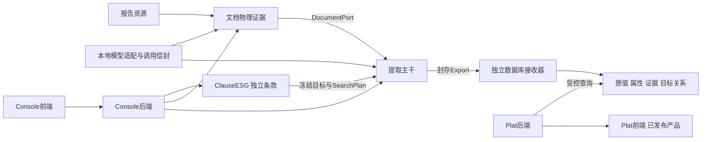

# 模块、合同与依赖

当前规范：2026-10-30。结果与实际运行证据在[升级验收](../implementation/2026-10-30/README.md)。

## 所有权和边界

一条声明位于 `ClauseESG/clauses/<展示组>/<条款ID>/clause.json`。组只有组织名称；命名集合只是编号列表。SDK独立安装，只依赖轻量合同，不导入提取、文档、模型或数据库。条款变化产生新摘要，新运行冻结副本；旧事实及旧条款快照不改写。

条款 `purposes` 分为捕获、属性补充、目标关联和比较。补充字段从 `enrichment.identity_axes` 读取，与 UI 显示列分开。必需比较轴只在 `comparison.required_axes` 撰写；旧 `value.comparison_axes` 仅用于旧版冻结读取。范围覆盖不能成为原值准入门槛；已知冲突归“其他目标”，未知字段保留。条款内的词典、阅读指令和注册规则由通用执行器消费。

原值只有 `QuantitativeValue` 与 `QualitativeValue`。`SourceFact` 增加报告/文档身份和可回读来源；`ReportedContext` 支持标准身份、任意维度及字段状态/证据。真实测量允许只有类别、量和单位；可选属性提议失败留诊断，已有原值继续保存。非测量编号、化学式、日期不进入定量事实。资源企业/发表年、目标固定口径都不能复制成实际测量身份。

提取主干依赖 `DocumentPort / ModelPort / ArtifactPort`。模型选择行、列或原文片段，确定性程序回读原值。物理证据、模型理解、条款关系、组织视图、长期数据库分别拥有数据；没有 Core 双路线或按16/32分支。

Console backend 拥有安全监视投影与会话接口；`application.py` 是本地应用组合根，将文档应用与队列/会话装配。文档算法不导入 Console 业务。前端只呈现服务合同，不计算测量准入或发布资格。

数据库拥有连接、SQL迁移、原值接收及冻结产品查询。Plat 通过独立 Python 客户端调用数据库模块，通过 HTTP EvidenceResolver 取得文档身份；不扫描提取/IR目录。Python wheel是SDK；部署数据库服务还需本模块Node runtime、queries、migrations和已安装Node依赖，可用 `ESG_DATABASE_MODULE_ROOT` 配置部署后的数据库资产根，或 `ESG_DATABASE_WORKER` 单独配置worker位置。不要将SDK安装成功冒充完整数据库服务部署。

## 窄接口

| 服务 | 接口 |
|---|---|
| 条款/提取18180 | `/api/clauses`、`/api/clause-groups`、`/api/clause-selections`、`/api/targets/freeze` |
| 文档18080 | `/api/report-resources`、`/api/report-assets/{id}/file`、`/api/evidence/{ir}`及search/read |
| 会话18080 | `/api/report-sessions`、preview、`/{id}/facts`、organized、cancel、archive |
| 监视18080 | `/api/console/monitor`：同一会话投影，安全字段，不传调度payload或目录 |
| 运行18180 | `/api/runs/{id}`、facts、organized、targets、candidates、exports |
| 接收18280 | `/v1/ingestion/exports`、`/v1/ingestion/receipts/{export_id}`、已接收facts |

`ResultAssessment` 分开执行、有限搜索覆盖、捕获结果、属性完整度、比较资格和结果分区；不同页面共用该投影。完成执行不要求所有可选维度齐全。旧版partial只按其冻结含义显示，不静默改成成功。

当前格式：clause1.2；两类值/SourceFact2.0；FactBundle2.2（兼容冻结2.1）；organized1.1（兼容1.0）；export/receipt1.0。跨服务只传ID、内容和摘要；文件根由各模块组合配置。当前本地编排单进程，多进程扩容前需提升提交唯一性和并发控制，不宣称已完成分布式部署。

物理OCR/IR可按PDF散列、实际处理计划和版本复用。模型理解每条每次重新执行，不跨条款/运行复用。搜索计划保留页/对象/上下文意图及延后字段说明；报告级未披露不从top-k未命中推出。

[组织规范](organization.md) · [模型规范](models.md) · [导出接收](delivery.md) · [操作](../guides/local-operation.md)

在已选择的表格中，数据行具有物理行单位、明确数值且期间由结构确定时，即使模型未选择它也保留为原值，初始关系未决，再由条款通用规则判别。它不向正文或无单位/无期间的歧义扩张；模型提议与结构补充分别记在调用诊断，表格没有被目标定义裁掉其他真实量。
