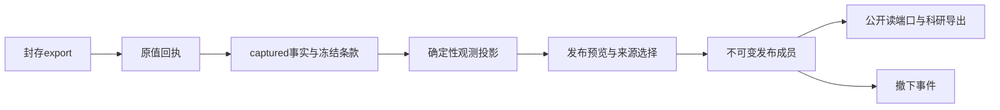

# 原值、科学观测与发布接口

当前源码接口，部署与真实结果另见[本轮实施记录](../implementation/2026-10-31/README.md)。不依赖旧55指标字典或提取结果目录。

原值接收与投影分开。回执成功后后台投影；投影坏行/代码错误保留失败状态，不改变已收原值与回执。可重试服务故障按预算重试，含义/格式错误须修复后显式重试。新转换版本不得改写旧投影，变更输出含义时提升transform_version。

## 身份与可用性

- source_fact_id保留具体理解版本；occurrence_id标识同PDF物理出现候选，缺bbox时仅对象级，不承诺跨IR修订匹配。
- observation_id绑定来源事实、冻结单条定义、原映射和转换版本；projection成员绑定一次接收快照。同格多条款保留独立解释，重复出现仅诊断，不自动合并、求和或丢弃。
- 全部期间与未知期间均投影。原值可浏览/下载不要求比较轴齐全；comparison.eligible另按冻结条款的比较用途、已读身份和范围证据判断，不补造口径。
- 报告企业、发表年和主覆盖年是资源信息，不替代实际统计主体与测量期间。

## 版本化来源选择

`source-selection-1.0`明确mode及要选择的关系分区，默认match。预览列出每条观测保留/排除原因和各期间数；原数据库内容不因选择而改变。

| mode | 行为 |
|---|---|
| all_sources | 保留所选关系分区的全部来源，去除跨投影重复的同一观测ID；不合并不同解释 |
| latest_report | 只在同冻结定义、期间、原单位、原行标签及可确认身份的比较键内按已知发表年选来源；未知身份、未知发表年及同年并列保留；不按上传时间覆盖 |
| prefer_explicit_restated | 只消费明确审定的重述链接；同定义、同已知期间且已知身份不冲突，不允许环；未被选择的新值不排除旧值 |

默认公开选择不包含uncertain/different分区；需要时通过policy.relations明确加入，并在预览中核对。所有分区仍留在内部原值/投影端口，未选不表示未提取。

## 发布与撤下

预览摘要绑定标题、投影内容摘要、来源策略、逐项决定和当时重述链接。发布重新核对摘要、来源血缘和计数，生成不可变dataset版本及成员。重复同请求返回同版本；撤下仅改变可见状态并追加操作者/理由/修订事件，不删原值、不改成员。重放旧发布请求不会恢复已撤下版本。

发布和重述控制要求本机操作者、同源请求和当前服务指纹。应用无自动发布调用，PLATESG_AUTO_PUBLISH=0。旧字典及旧快照读取实现已删除，只保留当前产品接口。

## 窄端口

| 数据库服务 | 用途 |
|---|---|
| v1/ingestion/exports/{id}/projection | 投影状态，POST显式重试 |
| v1/projections及/{id}/observations、definitions、export | 内部投影目录、完整分页、冻结定义、科研导出 |
| v1/datasets/preview、v1/datasets、/{id}/withdraw | 预览、显式发布、撤下 |
| v1/restatements | 明确重述关系 |
| v2/datasets及/{id}/observations、definitions、export | 仅已发布的独立读合同；撤下后不可公开读取 |

数据库拥有Python DTO、SQL事务和生成SDK：[contracts](../../database/contracts/README.md)。Console与Plat通过服务消费，不能直接打开对方产物目录或复制业务规则。所有事实/观测分页声明total、returned、next_cursor和query_digest；不可变成员为查询快照，游标不能串用到其他过滤或页大小。

## 科研数据与类型

科研ZIP包含facts、properties、evidence、coordinates、relations、sources六张长表、冻结definitions.json及manifest。properties按RFC6901路径展开原始标量，空对象/数组保留显式类型；bbox任意坐标在独立子表，不丢不认识的键。CSV没有JSON对象单元格，精确decimal字串不变。

Parquet按列实际精度生成decimal128/256，年份/页码为int32、期间边界date32、资格为bool，其余按合同string；实际Arrow列Schema记录在manifest。精度无法精确容纳在同一decimal256列时明确拒绝该Parquet下载，不舍入，CSV仍可完整导出。需要安装database[research]，缺依赖不退化成字符串Parquet。

默认单次科研下载容量为100,000观测与2,000,000展开行；触及容量则整个下载明确失败，可按期间/条款筛选，不返回伪完整截断文件。分页读端口可逐页取全。当前本地实现有界内存导出，超大研究集合后续应改作流式后台作业，不能把该实现称作无限容量。

## 安装边界

当前模式由0019原值、capture/0020产品、capture/0021来源保护组成。迁移文件不可改写，管理命令核对摘要；未受管的旧表不会被接管。只有显式管理命令安装模式，应用和桌面启动不迁移。当前数据库就绪与产品就绪分别声明；新部署使用干净的当前库，旧数据清理另记证据。
