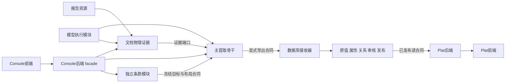
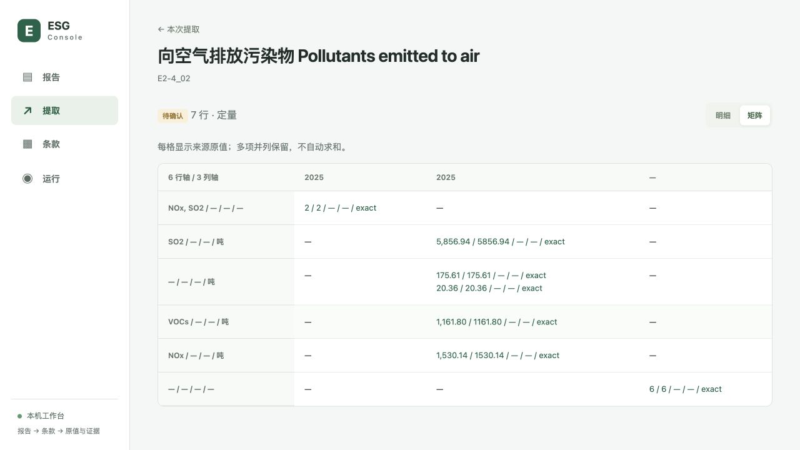
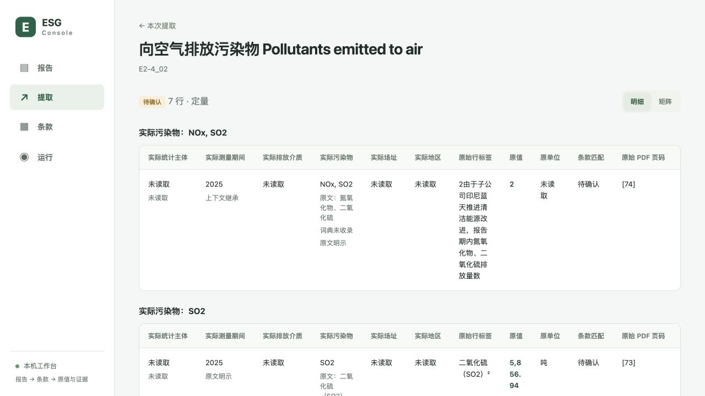

# 全盘模块化审核与下一阶段升级方案

日期：2026-10-30（Asia/Shanghai）

审查基线：`5385bbd79488b95b82a3a16d1c0840ddc39f997e`

范围：独立条款、报告资源、PDF/IR、模型、搜索、提取合同、结果组织、Console 前后端、Plat 前后端、独立数据库和文件布局。CrawlESG 不在范围内。

**本次是审查与方案交付，不是实施记录。** 审查使用当前源码、运行 API、冻结任务、模型回执、实际浏览器以及原 PDF；没有发起提取/模型调用、修改条款、重启服务、执行数据库迁移或清理业务数据。新增文件只有本报告、机器证据和界面截图。下文“建议”“目标接口”“验收”均属于待实施内容。

机器证据见 [evidence.json](evidence.json)。前轮结构报告和测试结果只能证明当时声明的工程边界，不能代替本轮科学语义核验。

## 1. 总体结论

**当前系统有可用的模块化骨架，但尚未达到“宽容接收真实测量、完整安放已有属性、按用途确认与比较、通过稳定接口独立部署”的目标。** 结构门禁通过，不等于科学性通过。

本轮最关键的发现不是简单地“合同太严格”，而是两个方向同时存在：

1. **对可选属性和目标范围过严。** 原值模型已经允许缺失主体、期间、范围、方法，但映射、组织和运行完成状态又把这些缺口变成阻碍；全部 1,126 条当前条款都有必需的集团范围条件。
2. **对“是不是测量值”过松。** 最新任务将化学式 `SF6` 中的“6”、脚注编号“2”保存为定量事实。有真实字符来源，仍不代表是实际测量。
3. **有效、非目标、非测量和属性不足混在同一结果表。** 7 条记录里，只有 3 条是本次空气排放目标；界面仍统一显示“7 行待确认”。
4. **独立模块仍有物理部署和运行目录耦合。** 条款数据/SDK仍属于 Extract 的安装根；Console 后端寄居文档 API；Plat 仍读取 Extract 的 IR 路径、导入共享运行源码；数据库的连接、部分迁移和启动由 Plat 持有。
5. **模型与搜索已有接口，尚缺统一执行合同和效果驱动的检索计划。** 本次 5 次模型调用中，后 4 次没有增加有效空气排放量，却耗时约 109.775 秒。

下一阶段应该采用的原则是：

> **严格核实“真实测量与来源”，宽容接收“报告未提供或尚未读取的属性”；执行、搜索覆盖、属性完整度、条款符合性、比较资格、发布资格分别表达。**

不能只把界面里的 partial 改成 completed，也不能通过删除守卫、补齐虚构维度或把所有有数字的文字都入事实来实现“通过”。

## 2. 审查方法与证据边界

| 核验 | 实际动作与结果 |
|---|---|
| 结构 | 重新运行只读 `audit_structure.py`：1,711 项，当前脚本规则下错误 0；不包含它自己的生成清单，也不等于逐行人工科学审读 |
| 合同 | 重新运行 `check_contracts.py`：1,126 条、37 阻塞、9 份 Schema、22 个生成模型通过 |
| 条款内容分布 | 273 定量、853 定性；1,094 组织模板、32 样本；不是 1,126 条都已做真实效果验收 |
| 当前服务 | 文档 18080 与提取 18180 的只读状态可读取；实际运行与源码合同一起检查 |
| 最新案例 | 查报告提取列表，确认最新为 14:30 的 `E2-4_02`，没有拿前轮能源试跑替代本次审查 |
| 原 PDF | 从受控报告接口取得 PDF，完整散列与原文件一致；渲染检查物理第 56、73、74 页 |
| 浏览器 | 实际进入报告 → 最新提取 → 条款结果，检查矩阵与明细，而非仅看 React 源码 |
| 反例 | 在内存中检验最小来源事实、可选属性警告、SF6/脚注数字候选；不保存到生产任务 |
| 数据库 | 阅读代码和接口声明，没有打开/迁移正式库或演示库，没有读取审核凭据 |

本次没有重新运行上一轮全部 552 项回归，也不将旧测试数当作当前语义正确性证明。尤其是“有物理来源的数字不是测量值”这一反例，现有接口与 Schema 能通过，仍然是错误结果。

原 PDF 的完整 SHA-256：`7ef566e38b68b8d96ef6369c88dc247f76b314a915121c8dc9bbe2785fa8fc6a`。物理第 73 页是一张横向双页，印刷页码为 141–142；不要把印刷页码和 PDF 页序混为一谈。

## 3. 宁德时代最新任务：到底提取好了没有

### 3.1 锁定的运行

| 项目 | 实际值 |
|---|---|
| 报告 | 宁德时代新能源科技股份有限公司 2025 年 ESG 报告 |
| PDF | `pdf-7ef566e38b68b8d96ef6369c`，92 个物理 PDF 页 |
| 会话 | `extract-plan-d5b786f343e3422ab8b0151509238420` |
| 提取运行 | `extract-c8adbfa8d23a8b65e5c8e73aa6c17237` |
| 条款 | `E2-4_02`，向空气排放污染物 |
| 冻结摘要 | `7121473456a5ea564fc286923267383892b02a65a33a3bdfd903a0d7e651bbdf` |
| 期间 | 2026-10-30 14:30:21 创建，14:30:54 开始提取，14:35:17 提取结束 |
| 准备 | 选取 15 页；识别、IR、质量阶段均完成 |
| 执行 | 5 个候选、检查 5 个、5 次模型调用、无执行错误；128 次调用预算未耗尽 |
| 结果 | 7 条定量记录，coverage=unconfirmed，organization=needs_confirmation，run=partial |

这次“部分完成”**不是任务仍在跑、不是调用预算用完、也不是没有找到数值**。它首先来自完成条件与质量/范围确认的绑定。完整结果仍有实际错误，不能因为执行完就宣称数据全部正确。

### 3.2 七条记录逐条裁定

| 当前保存的行 | 原值 | 原单位 | PDF 物理页 | 本次审核裁定 |
|---|---:|---|---:|---|
| 氮氧化物 NOx | 1,530.14 | 吨 | 73 | 本期空气排放量，数值和来源正确；主体/范围等可继续补充 |
| 二氧化硫 SO₂ | 5,856.94 | 吨 | 73 | 本期空气排放量，数值和来源正确 |
| 挥发性有机物 VOCs | 1,161.80 | 吨 | 73 | 本期空气排放量，数值和来源正确 |
| 化学需氧量 COD | 175.61 | 吨 | 73 | 真实水污染物测量；已被程序标 different，不应混入空气目标的默认结果 |
| 氨氮 NH₃-N | 20.36 | 吨 | 73 | 真实水污染物测量；已被程序标 different |
| 关于六氟化硫报警的正文 | 6 | 无 | 56 | **错误定量事实**：来自 SF6 的化学式，不是排放量 |
| 关于子公司减排的脚注 | 2 | 无 | 74 | **错误定量事实**：来自脚注编号，不是排放量 |

因此，本次案例的正确结论应是：**找到了 3 条有效空气排放原值；保留了 2 条非目标测量；错误纳入了 2 条非测量数字。** 这是对本次冻结样本的逐条核对，不是全报告精确率/召回率评测。PM、NMHC 等没有提取到，不据此宣布报告未披露，也不能凭这一表证明全部检索已经穷尽。

复核链接：[第73页数值表](http://127.0.0.1:18080/api/report-assets/pdf-7ef566e38b68b8d96ef6369c/file#page=73)、[第56页 SF6 正文](http://127.0.0.1:18080/api/report-assets/pdf-7ef566e38b68b8d96ef6369c/file#page=56)、[第74页脚注](http://127.0.0.1:18080/api/report-assets/pdf-7ef566e38b68b8d96ef6369c/file#page=74)。这些是本机证据接口。

### 3.3 原因链 A：为什么可用数值仍被阻挡

1. `SourceFact` 本身允许未知身份；本次内存检验仅有类别、12.3、吨和系统附加的来源信息即可通过，其他 8 类身份值为空。
2. `mapping_for()` 要求 scope 中声明的主体类别、实际/目标角色、总量、额外固定轴都得到支持；缺失就不能形成 covered scope。
3. 当前这一条的必需 scope 是“年度、集团、实际值、总量、空气”。报告是否正好明示这些属性，成为原值提取完成的间接前提。
4. 即使去掉这条 NOx 事实上的可选属性失败警告，内存重算仍是 `uncertain`，原因仅为 `scope_requires_confirmation`。
5. 组织器把任意 row flag 或 match!=match 都汇成 needs_confirmation；运行时又要求全部 covered 且 organized 才 completed。

**系统性程度：** 全库 1,126 条均有必需的 group scope；其中 1,019 为 annual、104 为 target_period、3 为 baseline_period。这是默认合同设计的普遍约束，不只是这一条提示词写得不好。

### 3.4 原因链 B：警告没有随最终证据更新

NOx 的最终 `reporting_period` 和 `pollutant` 都已是 stated，证据有效，但 flags 仍包含 `unbound_identity:reporting_period`、`unbound_identity:pollutant`。

原因：共享帧身份与行身份合并后，绑定器先记录一次无效提议的失败警告，后来同轴有效声明或确定性表头覆盖了字段，却没有重算最终诊断。**一次尝试失败被当作最终字段失败保留下来。**

保留尝试历史是合理的；让已解决的尝试失败继续阻挡最终记录不合理。应把 attempts 与 final field assessments 分开。

### 3.5 原因链 C：为什么“6”和“2”能进入事实

- `numeric_rows()` 通过数值正则枚举正文，只有日期等少量过滤；SF6 的 6、脚注 2 都成为带来源坐标的数字候选。
- 模型虽在 reason 中写出了“不是空气污染物”“2只是句子片段”，却仍把对应行放进 matches。
- 当前 `NumericMatch` 只有 match/uncertain，没有“不是测量/丢弃”的明确判别字段。
- 引擎接收 matches 后，只要物理行列与原字串可绑定，就继续构造 SourceFact。Schema 限制了引用合法性，**没有证明数字具有测量含义**。

正确修复不是强制每个数字有单位：无单位的真实计数也应接收。需要先判别 measurement / identifier / formula / footnote / date / unresolved；非测量保留为检索诊断，不进入测量事实集。仍然只保留定量、定性两份事实值合同。

## 4. 提取合同应该怎样宽容而科学

### 4.1 五个阶段分别判断

| 阶段 | 硬要求 | 不应强制 |
|---|---|---|
| 原值捕获 | 是真实测量或真实陈述；能回读原字串和来源；记录类型正确 | 每份报告都有子公司、场址、边界、方法、分母等 |
| 属性补充 | 有证据就保存；明确直接/继承/未知/冲突；允许扩展和原词 | 未识别类别硬塞进有限代码表；从目标或资源资料补造实际身份 |
| 条款关联 | 检查已知含义是否相容；确知为水体时不得当空气 | 未提供范围就判原值不可用 |
| 科学比较 | 按用途核对单位、期间、主体、方法、统计边界 | 因为原值被接收就自动视为可比较 |
| 审核发布 | 独立授权决定、批准规则和发布成员快照 | 执行完成/属性齐全自动变成可发布 |

“只有种类、量、单位也通过”的含义是：这三项能被确认为报告的测量，系统自动补上运行/报告/页码/来源编号，便可进入原值结果。系统溯源不是要求报告额外披露业务维度。反之，孤立的 SF6 下标有字符来源，也没有成为测量的资格。

### 4.2 单条合同需要重新分层

保留定性/定量类别、定义、词典、规则和输出布局的单条内聚，新增或明确这些**用途边界**：

- `capture`：读取什么原值，哪些来源能证明它是测量/陈述；基本准入规则。
- `enrichment`：可选身份、开放分类、局部字典、继承条件；缺失只记录完整度。
- `target_scope`：要寻找的范围与偏好，已知冲突如何关联；不整体冒充准入门槛。
- `comparison / publication`：什么情况下可比较、可聚合、可发布；严格条件留在正确阶段。
- `presentation`：建议默认列、紧凑值格式、可选矩阵；不应反向影响数据有效性。

这是下一版本合同设计建议，不是已经新增的字段。当前 `value.identity_axes`、`comparison_axes`、`output_scopes.required` 和 `required_for_confirmation` 需要逐项分类，不能简单全部设成 false。新建定量条款强制规范单位的规则也应限于需要规范化/比较的用途，不能阻止读取单位多样或暂未知的真实原值。

### 4.3 属性应“有位置”，不是“必须有值”

继续支持主体、期间、边界、方法、分母、地区、场址、污染物等标准字段与开放 dimensions。未知类别保留原词，附规范映射状态，不因词典没收录就使测量失败。

单位有则保留原文；缺失时标“未取得单位/未陈述/不适用”等准确状态，不直接写“未披露”。单位在表题、列头、脚注的有效证据，应通过声明允许的来源层级接收，不能只认固定的 row 层级。

可选属性提议错误：拒绝这条提议并记录诊断，原值继续保留。已知真实冲突：原值继续保留，关系标 different 或 conflict，不能伪装成适配目标。一个主体下多个工厂/多个期间/多条分项都独立存储，不合并、不填零、不自动求和。

### 4.4 状态合同的建议

```text
execution_state       completed / failed / cancelled / interrupted
search_coverage       bounded_complete / budget_stopped / evidence_missing / ...
capture_result        usable / empty / invalid / mixed
metadata_completeness partial / complete / not_requested
target_relation       relevant / different / unresolved
comparison_status     eligible / insufficient_context / conflict
publication_status    not_evaluated / approved / blocked / ...
```

具体名称在实施前冻结。Console 主状态优先表达执行是否结束，旁边分别显示数据量、有效测量、待补充属性及真正错误。属性不全不能一律称“部分执行”。本次任务可表达为“执行完成；3条空气测量；2条非目标测量；2条错误候选；属性可继续补充”。

不能仅把 runtime.py 的 else 改为 completed；需要让 DTO、队列结果、列表、详情、悬浮监视、导出和后续接收器共同消费这份新状态合同。

## 5. 模块工程性审核与目标边界

### 5.1 当前判断

| 模块 | 已有合理资产 | 当前缺口 | 下一阶段边界 |
|---|---|---|---|
| 独立条款 | 单条声明、SDK、摘要、冻结、选择集合 | 数据在 Extract/standard，SDK在 Extract/contracts；同一个安装包；科学内容多为模板 | 条款自有包/源/Schema/测试；通过窄 SDK 或接口提供冻结目标，不需要强行独立 HTTP 进程 |
| 报告资源 | PDF 身份、散列、元数据修订 | 默认 PDF 和控制库在项目外父目录；发现规则依赖工作区 | 独立资源仓储与稳定 ID；业务身份、物理证据与代码目录分离 |
| 文档证据 | OCR/IR/对象/字符引用不定义条款业务 | API还承担 Console 编排、队列、资源、兼容管理；旧数据路径自动发现 | 文档实现只负责证据；应用组合与 Console facade 移出其业务命名空间 |
| 主提取骨干 | 一条骨干、两类原值、文档/模型/产物端口 | 候选→测量缺少语义准入；终态与范围确认耦合；输出缺冻结交接清单 | 原值、属性、关系、覆盖、展示、交接各有明确合同和失败边界 |
| 模型执行 | 本地适配、约束解码、预算、诊断、取消 | 文档 ModelRunner、提取 MLX、OCR/Vision 各用不同调用/回执；预算重复裁定 | 共用执行信封、能力/有效预算和回执；各模块拥有专用输出协议 |
| Console前端 | 四对象路由、父子页、独立弹窗、共享生成类型 | 无常驻悬浮监视；结果表混杂、数值断行、矩阵重复年列 | App级任务监视 + 以可用测量为中心的结果工作台 |
| Console后端 | 文档API里已有编排与会话投影 | 没有独立的 Console 后端所有权；前端直连两组服务路径 | 明确 facade/BFF；只组合操作和展示 DTO，不复制提取规则或 SQL 业务 |
| Plat前端 | 独立产品应用、企业/指标/比较/证据 | 仍读取旧冻结产品；不能消费新事实输出 | 只读取已发布产品合同；不要把未确认原值直接接成公开指标 |
| Plat后端 | 公开字段投影、权限、历史发布 | 公开/管理职责同处；通过相对源码路径加载共享运行模块；直接读取 Extract IR | 发布读接口与管理命令分离；通过 EvidenceResolver 和数据库端口读数据 |
| 独立数据库 | 独立 SQL 源码、历史迁移、审核/发布血缘、精确数值 | 新接收器尚未建设；连接和部分plat迁移/启动仍由Plat拥有 | 接收、存储、审核决定和发布视图由数据库模块拥有；两个前端均通过受控端口消费 |

“独立”不要求每个模块一个微服务，但要求所有权、公开合同、依赖方向、测试、部署配置和数据位置清楚。一个大 wheel 安装方便，不等于条款、模型、文档、控制层已经可以独立演进。

### 5.2 建议依赖方向



图中数据库接收和新 facade 是目标能力。编排可以与 Console 后端同进程组合，但其执行状态机仍属于提取应用层；不能让 BFF 重新实现搜索、测量准入、审核资格或单位转换。已有 frozen 字典继续服务已有发布，不回写当前条款。

## 6. 模型调用与搜索定位的具体发现

### 6.1 这次实际用了什么

| 次数 | 证据 | 输入 tokens | 生成 tokens | 秒 | 有效目标增益 |
|---|---|---:|---:|---:|---|
| 1 | 第73页排放表 | 15,746 | 1,817 | 152.060 | 3条空气排放量；另选2条水体数据 |
| 2 | 第56页 RTO/SF6 正文 | 3,313 | 257 | 31.746 | 无；错误产生“6” |
| 3 | 第74页脚注 | 3,132 | 359 | 36.951 | 无；错误产生“2” |
| 4 | 第55页治理说明 | 5,146 | 51 | 22.624 | 无，返回空 |
| 5 | 第56页减排强度目标 | 3,356 | 101 | 18.454 | 无，返回空 |
| 合计 | 5次 | 30,693 | 2,585 | 261.835 | 不等于7条有效空气测量 |

提取总耗时 262.212 秒；回执总和与之接近，主要成本在模型。当前使用本地 Qwen3.5-9B-4bit，grammar_schema，纯文字帧；不能因为模型名称含 VLM 就说这5次都看了图。没有本次审查新增的模型调用。

语法约束只保证输出形状及引用枚举，不保证测量含义、相关性、完整度和最终警告正确。因此，不建议先靠换更大模型掩盖问题。

### 6.2 模型规范化方案

建立共用的 `ModelCallRequest / ModelCallReceipt / ModelCapabilities`，至少表达调用/所属运行、任务类型、模型/provider、真实输入模态、证据引用、prompt/Schema摘要、申请/有效预算、取消和时限、输出约束级别、输入输出tokens、耗时、失败类别及尝试血缘。凭据不进任务数据、报告、前端或日志。

当前提取任务允许申请8192输出tokens，适配器默认上限4096又取min；任务总时限和模型适配器时限也分开。应在调用前通过能力合同统一裁定并公开 effective_budget，避免前端以为一个设置已经生效。文档审查与OCR继续使用各自输出类型，不强行塞进定量/定性事实合同。

阅读分工改为：确定性程序保留来源、选清楚的期间列、提出字面量类别和已证实的局部词汇；模型处理测量语义、歧义和复杂上下文。无须让模型反复声明它不知道的主体、边界；不把资源公司名当事实输入诱导猜测。

### 6.3 搜索已经条款驱动，但还没有统一搜索计划

已落实：每条独立词典、负词、必需词组、表格/正文排序进入对象搜索；不是旧固定16条关键词路线。

尚有问题：

- 页级 PageSearchIntent 与对象级 SearchIntent 不同，编排只传部分字段；精确标签、结构锚、对象排除、预期类型等没有统一的编译/支持证明。
- 页选词会拆句、丢弃过长片段、最多保留16项；对象评分又有另一份权重和负词降权逻辑。不同层可以不同，但必须记录为什么变化，不能默默损失条款意图。
- `expected_candidate_types` 在条款有声明，当前搜索DTO/骨干未见对应实际消费。
- 生产编排创建 PDF 准备时固定 `mode="reprocess"`，不能将“禁止复用条款理解”理解成“每次都重做物理OCR/IR”。物理证据复用应按PDF散列、处理配置、IR修订和实际覆盖决定。
- 当前按top-k依次阅读全部候选；没有把表格事实、附属脚注、属性补读和额外测量发现分成不同任务。脚注应能补上下文，不应只把编号转为待提取量。
- 这次仅选15/92页，document.limited_evidence却为false：该标记主要表达IR可用性，不能充当全报告搜索覆盖证明。

建议由条款模块编译版本化 SearchPlan，分别产出页计划、对象计划、上下文补读计划；保留已消费/未支持字段、实际词项、排除原因与覆盖证据。文档模块只执行计划，不写条款语义。目标、搜索边界和实际测量范围保持分离。

物理索引可以复用，**跨条款模型理解仍不复用**。不要恢复已撤销的中立理解缓存。是否需要向量召回，先用漏召回样本证明，不能把 embedding 加回去就算优化。

## 7. Console：悬浮运行窗口与结果表方案

### 7.1 常驻但不抢主体的运行窗口

当前 App 根节点只有导航和路由页面，没有全局任务监视组件；进度主要在任务详情和运行页。用户切换页面后，缺少随时查看的统一入口。

建议 App 级 `RunMonitor`：

- 右下角收起为小按钮，显示正在执行/等待数量；点击展开为紧凑浮层，可固定、关闭、返回任务。
- 按报告 → 提取任务 → 准备/阅读阶段组织，显示准确页数、候选/目标数、已取得原值；不制造一个跨阶段总百分比。
- 模型状态、tokens与耗时另列，不能冒充业务完成进度；终态停止活动动画。
- 后端提供一份安全 MonitorSnapshot，包含状态修订、所属关系和允许动作，不返回原始调度payload、路径或凭据。
- 列表、详情、运行页与悬浮窗共享这一状态投影；不各算一遍“下一步”。现有去重/取消读取机制可利用，避免四组重复轮询。
- 支持键盘、焦点返回和窄屏；浮层不覆盖保存、取消或表格主要操作。真正失败保持可见；可选属性缺失只作补充提示。

当前服务已有队列事件流，但不能把带内部详情的原始事件直接当公开监视合同。先定义安全DTO，再决定SSE或有界轮询；不是先写一个会闪的浮框。

### 7.2 结果展示的真实缺陷



- 同一个“2025”出现两列：坐标散列保留了 stated/inherited 等来源状态，界面只打印 value，所以键不同但标题一样。
- 单格把原值、解析值、上下界、比较符用斜杠串在一起，出现 `5,856.94 / 5856.94 / — / — / exact`。
- 所有空轴仍显示，主要信息被一排“未读取”挤开。
- 不匹配的水体记录、SF6数字、脚注数字混在同一目标结果中。
- 切到明细后按组重复整张宽表，原始长行名使列被压缩，数值能断成多行；缺乏有效列选择、筛选、排序和紧凑预览。
- 原始事实表把缺失单位显示为“未披露”，但当前数据不支持这一断言。



### 7.3 推荐默认表：先让数据可读

以下为方案示意，不是已经改好的页面：

| 项目 | 期间 | 原值 | 单位 | 原文 | 属性状态 |
|---|---|---:|---|---|---|
| 氮氧化物 NOx | 2025 | 1,530.14 | 吨 | 第73页 | 主体/边界可补充 |
| 二氧化硫 SO₂ | 2025 | 5,856.94 | 吨 | 第73页 | 主体/边界可补充 |
| 挥发性有机物 VOCs | 2025 | 1,161.80 | 吨 | 第73页 | 主体/边界可补充 |

默认显示有效目标测量，独立入口查看“非目标测量2”“非测量候选2”“全部证据”。本轮2条错误候选需在新执行中纠正准入，不能只用前端隐藏来假装修好。

建议控件与规则：

1. 一张默认明细表，固定项目列/表头，原值右对齐、数字不换行；长标签截断并可展开原文。
2. 年份、单位、目标关系、未知属性过滤；排序、列选择、原始行/分组/矩阵切换；大集合分页或虚拟化。
3. 全空的可选维度默认折叠；有值时展示，可一键打开全部列；“未读取”和“未陈述”不能混用。
4. 一个显示格优先一个原始值；规范值、区间、比较符通过有标签的展开项显示，不重复堆同义数字。
5. 矩阵仅在维度稳定且数量合适时默认启用。坐标键按展示语义计算，来源状态留在行/证据标记中；如果刻意分开继承与直读，标题必须写清差别。合并展示坐标不合并事实，也不求和。
6. 证据抽屉/子页显示实际字段证据、完整来源、未决项；已知错配用独立颜色和说明，不统一叫待确认。
7. 提取结果下载属于原值产品，可提供有版本的明细/属性/证据表；数据库交接仍使用正式导出合同，不拿当前页面JSON当永久接口。

## 8. 文件、命名、中间产物与文档整理方案

### 8.1 真实现状

| 位置 | 当前职责 / 问题 |
|---|---|
| `ExtractESG/standard` | 1,227 文件（条款、99组、索引/选择）；文件多主要来自“一条一整体”，不是应删除的垃圾 |
| `ExtractESG/contracts` | 混合条款SDK、报告资源、事实、OCR/会话/操作DTO、组织语法；所有权不够清楚 |
| `ExtractESG/document/src/esg_document/document` | 同名层级重复、算法/合同/API职责需细分；大文件不自动等于应拆分 |
| `ExtractESG/document_ir_extract` | 旧名字仍承载真实 OCR/IR/.local 数据，不能直接按“旧目录”删除 |
| `ExtractESG/extraction/.local` | 当前事实、输入、证据、组织、诊断和运行SQLite；结果布局已有基本分层 |
| `ExtractESG/.local/python` | 开发依赖运行时，和业务数据不是同一种资源 |
| 项目父目录 `pdf/` | 18份实际PDF、报告目录及资源登记SQLite；默认运行需要项目外父目录布局 |
| 项目父目录 `.local/platform-runtime` | 队列、任务、锁、日志、旧名日志、备份及另一控制库并存；须核对实际引用与生命周期 |
| `PlatESG/.local` | 正式/演示库、备份、inbox、旧演示包和截图混放；本轮未删除或打开数据库文件 |
| `database/` + `PlatESG/backend/migrations` | 数据模式分两处迁移；数据库运行数据并不归独立目录统一管理 |
| 根目录与 docs、模块docs | 当前规范、原需求、上一轮实施记录、审计记录并存；需要明示“规范/历史/方案”而不是互相覆盖 |

源码里仍有 ESG_V2_* 配置名、targeted_extraction 等操作名、旧路径探测和跨模块相对导入。它们有的承担历史数据兼容，不能只做文本全局替换。

### 8.2 建议源码组织

```text
ClauseESG/                  独立条款：源/SDK/Schema/测试/编译目标接口
  clauses/<namespace>/<id>/clause.json
  src/esg_clauses/
  schemas/  tests/  pyproject.toml
ExtractESG/                 提取应用、文档证据和模型能力
  contracts/                只放本模块拥有的事实/运行/交接接口
  document/  extraction/  pipeline/  models/
  scripts/  pyproject.toml
ConsoleESG/
  frontend/                 现src迁入，App/功能/共享控件
  backend/                  facade、安全监视DTO、管理应用组合
PlatESG/
  frontend/  backend/       公开数据产品，不扫描Extract运行目录
database/
  contracts/  ingestion/  queries/  migrations/  tests/
docs/
  architecture/             当前规范与接口所有权
  guides/                   操作手册
  requirements/             原始需求依据
  audits/YYYY-MM-DD/        单次报告+机器证据+截图
```

这是目标草图，不是立即移动所有目录的指令。条款模块不必再恢复聚合包编译/活动版本注册表；命名集合仍只是条款 ID 列表。公共合同不应成为“所有DTO都往里放”的无主模块，接口随所属模块版本分发；真正通用基础只保留必要的ID、摘要和基础类型。

### 8.3 建议运行数据布局

```text
$ESG_DATA_ROOT/
  reports/blobs/<sha256>.pdf
  reports/registry.sqlite
  documents/<document_id>/<revision>/{ocr,ir,evidence}/
  extractions/<run_id>/
    input/                  冻结输入、条款、配置与代码身份
    results/                两类原值、关系、覆盖
    views/                  可重建组织表与矩阵
    diagnostics/            候选、拒绝、模型回执与尝试历史
    manifest.json           产物版本、摘要、计数、完成/冻结状态
  control/{queue.sqlite,locks,events}/
  logs/<service>/
```

运行依赖/模型缓存用独立 runtime 配置；数据库连接或存储根由数据库模块显式配置。原始PDF文件名保留在元数据，不必为了整洁丢掉来源名称。迁移不自动移动正式/演示库，二者单独演练和确认。

**关键不是把目录改漂亮，而是取消运行时凭目录名猜数据位置。** 通过显式配置和资源注册表解析旧引用；传输永远用稳定ID/版本/摘要，不把 data_root 或绝对路径写成交接接口。

### 8.4 安全迁移与清理顺序

1. 先制作当前配置、资源引用、产物和保留原因清单；配置核验不输出凭据值。
2. 仅生成 dry-run 迁移计划，区分原始资产、冻结产物、可重建视图、诊断缓存、依赖、备份、废弃源码。
3. 建立新显式根与读取注册表；先复制/校验，不先删旧位置。
4. 逐项比对 PDF/IR/事实摘要、数据库来源引用、页码和对象定位；新根读取与旧根一致后切换。
5. 冻结任务保持旧快照，不能因“统一目录”重写语义或破坏证据。
6. 可重建视图和无引用中间物经过引用检查/保留期后清理；备份只有确认可恢复且无保留要求后再处理。
7. 原配置名分阶段迁移并报告弃用；旧路径探测在引用迁移完成后移除，避免永久兼容层。

文件命名按语言惯例保持一致；原条款编号、公开契约版本、数据库迁移文件和原始资产身份不能随意重命名。大文件以“变化原因与职责”拆分，不能按固定行数机械拆碎 PatchGuard 等内聚算法。

## 9. 提取输出与独立数据库接收方案

### 9.1 现状不能称为已经对接

当前 FactBundle 有文档、事实、目标摘要、关系、覆盖、摘要与组织引用，基础合理；但仍是可增量重写的运行结果，缺少独立且封存的导出清单、内容文件摘要、交接版本协商与接收回执。`OrganizationResult.url` 也不是可脱离生产服务存活的长期数据交接定义。

新接收器不存在；旧 import/delivery 写入口在当前源码中显式退役。Plat 的部分候选/来源定位仍通过 `PLATESG_IR_ROOT` 读取 Extract 的 IR 文件；冻结收据查询仍解析旧bundle路径；发布运行身份还通过相对源码路径导入 Extract 的共享运行模块。合理的历史读取应被标为冻结适配器，不能用来设计新接收合同。

数据库源目录独立，不代表运行职责已经独立：Plat 的 worker 仍负责打开数据库、执行两套迁移、登记字典。后续应把schema版本管理和启动迁移交给数据库模块的显式命令，应用启动检查版本，不自行迁移生产库。

### 9.2 建议交接合同

建议新增版本化 ExportManifest，独立于视图、运行目录和 Console：

- producer/run/document/PDF身份、IR修订、引擎身份、冻结条款摘要；
- 导出版本、封存时间、完成/部分结果范围、内容摘要和记录计数；
- facts、reported_properties、evidence、clause_relations、coverage、diagnostics 的清晰成员；
- 证据使用稳定资源引用与摘要，必要时提供受控解析端口；不保存凭据URL；
- 接收前校验引用、身份、摘要、两类值和测量资格，缺少可选维度不拒绝；
- 合法原值与错误候选隔离，目标不同不改写原值；所有非目标/候选的处置仍可追溯。

数据库接收器拥有幂等键、输入摘要、事务、行级处置回执和可恢复状态。同键同内容返回原回执；同键不同内容拒绝；确认回执前不自动重发不确定的写入。接收成功、审核通过和正式发布是三种决定。

建议长期实体：报告快照、运行/目标快照、来源测量事实、可选属性、字段证据、条款关系、审核决定、正式观测、发布成员。规范化数值用精确十进制，原字串始终保留；不以矩阵坐标为主键，不把报告企业无条件当测量主体。

## 10. 具体修复清单与落点

| 编号 | 优先级 | 修复项 | 首要代码落点 | 验收要点 |
|---|---|---|---|---|
| F01 | P0 | 数字候选与真实测量分开 | document/literals.py；extraction/decisions.py、engine.py、binding.py | SF6的6、脚注2不进测量事实；保留诊断；合法无单位计数仍能进入 |
| F02 | P0 | 执行与质量/范围分离 | runtime.py；contracts/sessions.py、facts.py；pipeline/extraction.py | 可选维度缺失不使已完成执行变partial；真实执行停止/错误仍准确 |
| F03 | P0 | 条款范围/属性按用途分层 | esg_clauses/contract.py、parts.py、scope.py；各clause.json | 集团目标不成为所有报告的隐式准入条件；已知冲突不被放过 |
| F04 | P0 | 最终字段诊断重算 | binding.context_from_claims/mapping_for | 最终已绑定的期间/污染物不再保留未绑定阻断；尝试历史仍保留 |
| F05 | P0 | 有效/非目标/非测量结果隔离 | organization.build_organized_dataset；结果查询DTO | 空气默认3条；水体2条独立；非测量2条在新执行中进入诊断 |
| F06 | P1 | 矩阵坐标与值格式修正 | organization._coordinate_keys/_matrix；results.tsx | 不出现无解释的两个2025；一格不串五个无标题值；不丢行/求和 |
| F07 | P1 | 表格与准确缺失词 | Console results.tsx / detail.tsx / styles | 数值不换行；可选空列折叠；null单位不称未披露；能筛选和追证据 |
| F08 | P1 | 统一运行悬浮窗 | Console App + backend MonitorSnapshot | 换页可看；与列表/详情同一状态；无伪百分比和原始payload泄露 |
| F09 | P1 | 模型执行信封与预算统一 | extraction/models、document/models及ocr适配 | requested/effective预算、取消、真实模态、验证级别和调用回执一致 |
| F10 | P1 | SearchPlan及物理证据复用 | clause检索编译；PageSearchIntent；pipeline/extraction；evidence_service | 字段无静默遗漏；复用OCR/IR但不复用跨条款理解；有搜索范围证明 |
| F11 | P2 | 模块所有权/安装边界 | pyproject；Clause模块；Console facade；Plat runtime | 可不依赖完整Extract目录部署条款/Plat；无源码sys.path注入 |
| F12 | P2 | 数据根/文档/配置迁移 | esg_runtime/layout；document/config；启动与资源注册表 | 新检出和旧工作区一致；旧证据全可读；原始资产/活动数据库不受损 |
| F13 | P2 | 独立导出与接收回执 | results/artifact端口；database/contracts、ingestion | 原值+稀疏属性可收；重复/冲突/部分失败可核验；无目录读取 |
| F14 | P2 | Plat与数据库运行边界 | Plat/db-worker、database连接/迁移、evidence_location | 接收/迁移由DB拥有，Plat只消费读合同；历史冻结适配隔离 |
| F15 | 持续 | 真实效果基准和内容成熟度 | 正反例夹具、真实报告基准、条款acceptance | 机械测试、科学内容验收、公开批准不互相替代 |

代码导航与起点：

- [R01 原值及可选身份合同](../../../ExtractESG/contracts/src/esg_contracts/facts.py#L50)
- [R02 当前完成条件](../../../ExtractESG/extraction/src/esg_extraction/pipeline/runtime.py#L85)
- [R03 元数据绑定与历史警告](../../../ExtractESG/extraction/src/esg_extraction/pipeline/binding.py#L81)
- [R04 scope与映射门槛](../../../ExtractESG/extraction/src/esg_extraction/pipeline/binding.py#L455)
- [R05 正文数字枚举](../../../ExtractESG/document/src/esg_document/document/literals.py#L33)
- [R06 模型选择合同](../../../ExtractESG/extraction/src/esg_extraction/pipeline/decisions.py#L36)
- [R07 所有matches生成事实](../../../ExtractESG/extraction/src/esg_extraction/pipeline/engine.py#L290)
- [R08 组织状态与混合行](../../../ExtractESG/extraction/src/esg_extraction/pipeline/organization.py#L345)
- [R09 矩阵坐标](../../../ExtractESG/extraction/src/esg_extraction/pipeline/organization.py#L285)
- [R10 矩阵显示](../../../ConsoleESG/src/features/extractions/results.tsx#L232)
- [R11 页面外壳](../../../ConsoleESG/src/app/App.tsx#L86)
- [R12 当前搜索](../../../ExtractESG/document/src/esg_document/document/evidence_service.py#L134)
- [R13 PDF准备固定重做](../../../ExtractESG/pipeline/src/esg_pipeline/extraction.py#L387)
- [R14 默认数据布局](../../../ExtractESG/shared_runtime/src/esg_runtime/layout.py#L23)
- [R15 原值集合合同](../../../ExtractESG/contracts/src/esg_contracts/results.py#L41)
- [R16 Plat读取IR目录](../../../PlatESG/backend/main.py#L898)
- [R17 数据库启动所有权](../../../PlatESG/backend/db-worker.mjs#L10)
- [R18 跨源码根运行导入](../../../PlatESG/backend/runtime.py#L4)

## 11. 下一阶段实施顺序和验收

### 第一批：先修科学语义与宽容合同

实施 F01–F05。冻结本次7条作为带期望处置的反例集；修好后新执行应得到3条空气目标原值，2条水体为非目标，2条非测量拒绝进入事实。数值3项全部与原PDF一致；缺失主体/方法不阻止原值接收。原冻结运行不改写，保留新旧比较。

同时增加以下用例：仅类别/量/单位；无单位真实计数；丰富子公司/场址/边界；未收录类别；显式0；破折号和空白；区间/上下限/强度；定性原文；单位在表题/脚注；同轴无效提议后有效证据；确知水/气或量/强度冲突。不能靠把所有要求取消让反例也通过。

### 第二批：调用、搜索与展示

实施 F06–F10。先稳定状态/监视/结果查询合同，再做悬浮窗和表格。以相同PDF/冻结条款比较有效目标数量、错误测量、属性保留、漏召回、实际tokens、时延和模型调用数。后4个正文候选的109.775秒是优化观测点，不是承诺可直接删除4次调用；别的报告可能确实把测量放在正文。

### 第三批：所有权与文件迁移

实施 F11–F12。先端口与配置，后物理移动。逐项执行dry-run、复制比对、读取切换和回滚；保留被历史引用的冻结数据。条款、Console facade、Plat与数据库可在同仓开发，但不再靠彼此源码路径或输出目录运行。

### 第四批：导出与独立接收

实施 F13–F14，仅在隔离库验证；最后才考虑活动库迁移。必须演练同键重试、同键不同内容、断网未知结果、部分坏行、缺少可选属性、源证据缺失、旧合同版本和撤销/重新导出。接收可用原值，不自动发布。

### 持续的效果验收

至少按中文/英文、原生文字/扫描、简单三字段/复杂组织、表格/正文、定量/定性分层建立人工标注报告集。分别测量：真实测量准确率、目标相关性、已标注范围内召回率、原值/单位/期间正确性、已有属性保留率、证据一致性、错误数字误入率、模型成本、人工修订量。

unknown字段不自动算提取失败；报告确有属性却漏掉应计入属性召回缺口。未标注或未搜索的范围不能拿来宣称全报告召回率。结构门禁与Schema回归继续执行，但不替代这些指标。

## 12. 与原升级规划的对照及本轮交付

| 原规划 | 当前审查结论 |
|---|---|
| 阶段0真实基线 | 有试点和结构检查；尚缺能检出SF6/脚注伪事实的正式科学基准 |
| 阶段1统一条款合同 | 单条唯一源已形成；用途、范围和完成准则仍需分层，接收/比较端尚未共同消费 |
| 阶段2统一事实 | 单骨干、两类值已形成；候选字面量与真实测量尚未彻底分清 |
| 阶段3文档与搜索 | 条款驱动已用上；物理复用、统一计划与搜索覆盖证明待完善；跨条款理解缓存按后续要求继续禁止 |
| 阶段4科学数据产品 | 既有冻结产品保留；新格式的导出/接收还没有形成生产闭环 |
| 阶段5条款中心 | 可浏览编辑冻结；1,094模板、37阻塞不等于科学验收完成 |
| 阶段6Console | 已有对象导航基础；悬浮监视、科学结果表和准确分轴状态仍缺 |

本轮交付的是可以据此实施的审查报告、机器证据及两张实际界面截图。**没有把上述方案写成已修复，没有改变当前任务、条款、数据库或运行服务。** 建议下一阶段首先完成F01–F05，再以真实数据驱动后续界面、文件和数据库升级。
