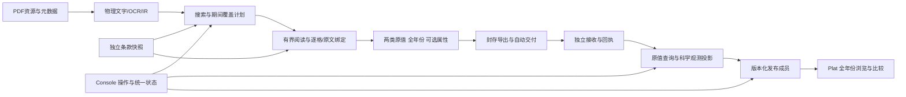

# 多年份原值保全与 PDF—数据库—Plat 全流程复审

审查日期：2026-10-31，Asia/Shanghai。源码基线：`48789a27`。依据：用户本轮明确要求、[原升级规划](../../../全链路检查报告与升级规划.md)、[上一轮实施验收](../../implementation/2026-10-30/README.md)。

本轮交付是**只读审查、下一轮修复设计和制作说明**。没有修改生产代码、条款、冻结任务或数据库，没有重新调用模型、重启服务或导入新事实。新增审查文件及两份指南；机器证据在 [evidence.json](evidence.json)，可运行 [collect.py](collect.py)复核。SQL结论来自源码和现有HTTP回读，没有直接打开正式/演示库。

## 1. 需要纠正的核心判断

**上一轮解决了“缺失属性不阻止原值接收”，没有解决“披露的各年份都应被提取”。当前生产选列仍截断历史年份，所以不能把执行完成和18条接收成功解释为原表数据完整。** 原规划阶段2本已要求“不同年份无丢失”，本轮发现这项未真正达成。

本轮确认的业务原则应作为下一版实现依据：

1. 一份2025年度报告中的2023、2024、2025测量都要保存，各为独立原值；发表年份和报告主覆盖期不限制事实年份。
2. 年份是“报告说了什么”的属性，不是原值准入条件。没有可靠期间的真实测量也保留，标为未知；有明确期间就尽量读取，不以“可缺失”为理由漏提已存在的属性。
3. 原值捕获与条款关联分开。历史实际值仍是实际值；只有报告明确说是基准、目标或重述时才赋予相应角色。其他目标的真实量也保留，不能混入本目标默认表。
4. 后续数据库投影与Plat负责多来源选择、同期间冲突、重述、比较和时间序列；不能靠提取阶段丢弃旧年份简化这些任务。
5. 定量与定性仍是两份值合同。年度、季度、期末、累计、目标、基准、重述都属于身份/角色/来源关系，不另建第三种值类型。

## 2. 真实案例：三年披露，当前只保留一年

本轮复核原PDF完整物理第73页，印刷页141–142；SHA-256为 `7ef566e38b68b8d96ef6369c88dc247f76b314a915121c8dc9bbe2785fa8fc6a`。原表与冻结IR的列一致：`c2=2023`、`c3=2024`、`c4=2025`。

| 空气污染物 | 2023，吨 | 2024，吨 | 2025，吨 | 当前冻结任务 |
|---|---:|---:|---:|---|
| 氮氧化物NOx | 217.83 | 2,841.70 | 1,530.14 | 只保留2025 |
| 二氧化硫SO₂ | 13.78 | 12,067.14 | 5,856.94 | 只保留2025 |
| 挥发性有机物VOCs | 771.14 | 1,094.32 | 1,161.80 | 只保留2025 |

任务：`extract-1099dd301a241c409a0ab052027c689c`；封存：`export-53416b2c235c075addd352562fb717bf79fe9ba8ba3590024f34f1f1166d17ab`。

- 这3行应有9个年度原值，实际保留3个，缺6个。**这只是本表这3行的年度保留核验，不是整份报告的召回率。**
- 当前结果18条全部为2025；接收器HTTP回读同样是18条、全部2025。它没有把2023/2024拒收，生产者根本没交付这些年份。
- 同表另有水体和固废测量。在内存中逐单元格调用现有绑定器，可构造51条原值：2023年15条、2024年18条、2025年18条；3个“/”不构造数值或零。再组装内存ZIP，现有接收解码器接受51条、拒绝0条。
- 上述51条是**格式/绑定能力探针**，不是新的模型提取任务或SQL入库结果，也不证明全表所有语义、属性均已验收；三个空气项目的九个值已对原PDF核验。
- 旧任务保持冻结。它的completed表示当时执行结束；不能后台把三年数据塞入旧任务，必须修复后新运行、新封存、新回执。

复核原文：[本机PDF第73页](http://127.0.0.1:18080/api/report-assets/pdf-7ef566e38b68b8d96ef6369c/file#page=73)。

## 3. 根因定位：不是单改年份字段就够

### 3.1 结构选列只认报告主年份

[`period_columns()`](../../../ExtractESG/extraction/src/esg_extraction/pipeline/structure.py#L7)仅返回年份等于`document.reporting_year`的唯一列。实测返回`['c4']`。没有主年份时则返回None，即使表头已经明确列出多个年份。

### 3.2 引擎覆盖模型的列选择

[`engine.py`](../../../ExtractESG/extraction/src/esg_extraction/pipeline/engine.py)将结果放入`physical_period_columns`，提示模型只用这些列；绑定前又执行`match.columns = decided_columns`。因此只改提示词为“读取所有年份”也无效。结构补充同样只保留这些列；这是两处一致但错误的截断。

### 3.3 annual 被解释为主报告年

[`mapping_for()`](../../../ExtractESG/extraction/src/esg_extraction/pipeline/binding.py)在annual范围下把事实期间与`document.reporting_year`直接比较。内存隔离探针仅设一个annual范围，2023、2024均不能覆盖，2025可以。新用途分层使它不再直接拒收原值，但会继续污染覆盖和比较结论。**annual应说明期间粒度，不能暗含“必须等于主年份”。**

### 3.4 缺局部年份时无条件继承主年份

同一绑定器在表格列没有年份、模型没提议期间时，可直接继承document.reporting_year。构造“数值”列、无局部期间的反例，得到inherited=2025。此探针没有证明实际案例已经错标，但证明默认规则过宽：正文中的历史、目标、累计、财年或时点数据可能被贴上主年。

文档期间检测虽曾得到basis、evidence、source_id，`DocumentReference`却主要留下单个year，`reporting_period_raw`被简化为年份字符串。后续继承因此不能完整解释“为什么这条量属于该期间”。应保留真实期间声明与适用范围，且缺期间不阻止原值保存。

### 3.5 既有验收只标了2025

上一轮“五条5/5”包含3条空气、2条水体，实际只覆盖2025。该狭窄基准无法检出另两年遗漏。自动接收18/0验证传输成功，不证明生产者覆盖充分；结构门禁和Schema通过也不能证明语义完整。

## 4. 全盘模块审核

| 模块 | 已具备且应保留 | 本轮缺口与需要改变的边界 |
|---|---|---|
| ClauseESG | 一条一整体、完整摘要、冻结、独立SDK；组和16/32集合不决定路线 | 明确期间粒度/事实角色，消除annual=主年的含义；补齐读取属性；清理37条迁移阻塞；内容成熟度独立于ready |
| 报告资源 | PDF散列身份、元数据修订、批量导入 | publication_year和单个reporting_year不足以表示披露多个年份；资源年只能是说明，不能裁剪值；导入必需元数据与真实原值可稀疏应分开 |
| 文档证据 | 原生文字、OCR、表格/正文、行列证据、物理复用 | 期间检测依据丢失；跨页续表、混合表头和列级身份要可追踪；增量补证不能只留top-k |
| 提取骨干 | 两类原值、模型选择引用、程序回读、候选分类 | 去除主年覆盖；同一行所有披露期间分别绑定；多列的主体/方法/角色也必须分别绑定，不能只换year |
| 模型 | 共用调用信封、本地Qwen、受控输出、预算与取消 | 多年不要机械拆成每年一次调用；按对象/行组和输出预算分块；模型不返回自由生成数值；量化成本需真实复测 |
| 搜索定位 | 条款编译SearchPlan、页/对象意图、物理OCR/IR复用 | 17/92页是有限证据；对象接口只返回top-k列表，没有完整候选总数/续读证明；历史值可能在续页，需按覆盖缺口扩展 |
| 组织及Console | 目标/其他/未决分区、表格/矩阵、统一运行窗 | 当前只能展示生产者交付的一年；应默认全年份，增加期间分布和漏读诊断；接收入库与发布状态尚未贯穿到同一业务流程 |
| 数据库接收 | 独立ZIP/回执、精确numeric、可选属性、幂等、完整记录JSON | 可存多年份，不是根因；facts查询固定LIMIT1000且无游标；接收worker启动仍检查旧dictionary_membership，init仍登记旧字典 |
| 科学观测/发布 | 旧冻结字典、审核决定、观测和发布快照资产 | 新captured_*到旧curated/发布没有投影桥；当前条款摘要未成为新产品定义源；不能恢复旧包导入接口来绕过 |
| Plat | 旧已发布产品读取、期间过滤、比较、来源展示 | 新接收数据尚不可直接展示；原值浏览、科学观测、比较资格应分层；公开PDF默认根仍保留旧父目录配置 |
| 部署/文件 | 独立数据根、SDK、桌面后台控制器、规范与历史分层 | 保留当前收口，不再做无目的大搬迁；新发布层通过服务/独立数据库合同对接，不指向Extract结果目录 |

条款总计1,126：273定量、853定性；1,089技术ready、37blocked；组织配置32条sample、1,094条template。技术ready不等于内容完整。另有**803条**的`value.identity_axes`部分轴没有进入`purposes.enrichment.identity_axes`。这是静态声明差异，可能包含有意仅用于比较的字段，不能直接算803条实际漏提；但当前reading_card只按enrichment请求属性，必须逐条解释和归类，不能假定字段“有位置”就一定会被读取。

## 5. 下一版合同：容纳信息，而非预设报告必须齐全

### 5.1 四份职责清楚的接口

| 接口所有者 | 应明确的内容 | 不应承担 |
|---|---|---|
| 单条合同 | 定性/定量、概念、词典、目标角色、可选属性、搜索/阅读、显示与比较条件 | 某次报告只许提某一年；源文件路径；永久数据库表名 |
| 提取公共合同 | 两类原值、期间/主体/字段证据、候选选择、目标关联、执行/覆盖与交接 | 条款专用关键词；平台挑选最新年/同业比较策略 |
| 数据库模块合同 | 原值与解释版本、目标关系、精确值、期间索引、投影/发布血缘、分页回执 | 从生产者目录猜输入；重新调用模型解释同一原值 |
| 平台读合同 | 全年份/多来源浏览、观测选择、比较资格、版本与发布视图 | 反向要求提取层丢弃旧年份或补造缺失属性 |

### 5.2 期间设计建议（未实施）

提取策略默认并固定为“所选条款与候选证据内，保留所有已披露期间”。创建提取任务不提供会静默丢弃历史值的默认年份过滤。平台/表格的年份筛选只影响查询与显示。

通用期间值建议允许：原词、kind（annual/fiscal_year/quarter/instant/range/unknown）、可选year/start/end、来源状态与证据。start/end无法确定时保留原词，不猜自然年边界；跨年累计值是一条range事实，不拆造逐年值。年份、值角色、重述版本是不同字段。该建议扩展现有ReportedField载荷/标准解析，不增加值数据种类。

文档的报告覆盖期声明是上下文。只有明确适用于当前表/句、无局部反证时才允许继承，记录真实证据和依据。不能从报告标题年、发表年或一个最高年份自动推断每条量的期间。未知期间仍能接收入库，平台明确标“期间未知”。

结构输出应是完整列语义计划，而非单个current_col：列ID、完整表头路径、期间候选、主体/方法/角色候选及歧义。模型可对有界同表选择多列；程序逐格绑定原值和列级属性。若相邻两列都是2024、但分别为集团/子公司或市场法/位置法，应保存两条，不能去重成一个年份列的单值。

### 5.3 属性和比较

capture只要求真实测量/陈述及可回读物理来源。enrichment尽量读取报告已有的主体、场址、方法、分母、地区、细分类等，允许未收录原词和扩展。属性不可用只影响属性状态。已知冲突改变目标关系，不删除原值。

comparison.required_axes限制“某项比较能否做”，不限制原值接收或基本展示。平台可以展示2023–2025原值并标注口径未确认；跨企业聚合、强度重算或同口径趋势计算才消费相应资格。不能把缺少集团范围再次变成“Plat完全不可见”。

## 6. 37条未决条款：它们是什么

它们是**当前条款仓储中readiness=blocked的37个声明**，不是37条坏数据，也不是这份宁德时代报告缺失37项。

- 36条共用“原条目为混合披露或结构要求，须明确值级数据种类和证据合同后启用”的迁移理由，当前暂标qualitative。其中包含表格结构条目，也包含含义已很明确的说明性条目；统一阻塞不够精细。
- 1条是`E1-5_19`“高气候影响行业能源消费总量”：canonical_unit缺失，且unit_dimension/阅读规则仍是energy-intensity，与标题的总量含义冲突。**缺规范单位本身不应阻止原值捕获，概念维度冲突仍必须修正。**

完整编号、主要名字、当前理由和逐项建议见[37条明细](unresolved-clauses.md)。建议不等于已改变官方分类或已启用条款；本轮不读取外部旧标准文件夹，也不把源码里source_ref字符串冒充完整可查的标准原文证据。

下一轮应把“来源标准条目是什么”与“可执行值目标是什么”分清。结构条目可作为结构描述或成员视图，不能假装是一条定性原文事实；若其本身含明确数值目标，可直接建成一个返回多行的定量条款。真正混合的量和说明分别拥有独立条款，通过非执行关系关联，不增加mixed事实类型、不自动执行兄弟条款。明显可作原文提取的条目应完善定义与证据后解除迁移阻塞，无需等齐所有可选属性。

## 7. PDF → 数据库 → Plat 的目标全流程

前半段已具备骨架但存在本轮截断；后半段`captured_* → 新观测投影 → 新发布成员 → Plat`是**待建设接口**，不是已上线流程。

### 7.1 资源、提取与交付

一份原PDF只登记一次，保留原始完整字节和散列；不要按年份裁成三份PDF或手改表头。元数据说明报告归属；实际量的年份/主体读取自报告。冻结条款、搜索计划、文档修订和引擎身份后执行，所有年份单独形成SourceFact。

每条结果包括原值/原文、原单位、期间和其他可选属性、物理定位、目标关系；未知值显式未知。确定性程序回读原字串，不让模型生成金额、换算或求和。输出整理按事实行、属性、证据、关系、覆盖分表，显示矩阵可重建，不作为数据库主键。

结束后自动封存并交付，原值不等人工批准。当前传输已包含facts/properties/evidence等八份成员；接收器实际从facts重建属性/证据，另两份虽校验文件摘要，却不比较语义一致性。下一版必须声明facts为权威、其余为可重建投影，或选择唯一规范化权威；不能让不同消费者各取一份并得到不同结果。一次接收边界检查即可，不在每层反复调用模型核值。

### 7.2 独立数据库原值层

保留当前captured_facts完整JSON与精确numeric。期间、主体、值角色、开放维度作为可查询属性，未知期间不拒收；需要分面/排序时可建投影索引，但不把可重建字段变成第二份手写事实。

新增明确的接收集合/记录分页接口，提供总数、returned、next_cursor和查询快照，取消静默LIMIT1000。回执按集合计数核对，数据超过1000也可读全。原值可直接下载长表，重述和冲突不靠覆盖旧行处理。

数据库独立不只指文件归database所有。当前[`worker.mjs`](../../../database/runtime/worker.mjs)启动先要求旧`dictionary_membership`存在；[`manage.mjs init`](../../../database/runtime/manage.mjs)也一并安装旧平台模式、登记旧字典。下一版应提供明确的capture/publication能力配置，原值接收只要求自己的模式版本，历史发布读取按其冻结资产加载；无须为接收新条款先安装旧55指标体系。

物理出现、解释版本和科学观测应有不同身份：同一PDF单元格可能被多个条款或运行独立读取，当前fact ID含interpretation，不同解释保留；投影时按来源锚与身份识别候选重复，不能直接把多个条款保存的同一值相加。这里复用的是物理身份与血缘，**不恢复跨条款模型理解缓存**。

### 7.3 观测与发布层

新增投影读取端口消费接收快照和冻结单条合同，不要求旧Core/旧大包或旧55指标字典。数据库模块拥有观测/决定/发布结构与事务；条款模块提供定义，Console提供操作，Plat只消费稳定读接口。新字典或产品定义由冻结条款生成，不在平台另写科学口径。

研究导出明确分为事实长表、属性表、字段证据表、条款关系表和来源表。数值保持精确decimal、期间保留类型和原词，开放属性进入规范的子表。现有旧scientificProduct的Parquet实现将字段全部转成string；它不能直接当作新产品的科学类型规范。新产品应有明确列Schema/decimal类型，不在一个CSV单元格中塞整份对象，不把已声明limited的旧100,000行接口误当无上限导出。

投影是确定性的组织过程：保留各年份、主体、方法与来源；可解析字段自动生成，身份不充分的量进入可浏览原值而不是被删除。科学观测保留来源链接、口径、重述/取代关系及比较状态。无需为了接通而把所有缺维度事实人工补齐。

发布成员应引用明确观测/原值快照和条款摘要。自动化可做到接收→投影→候选发布集；对外发布仍按明确配置和决定执行，`PLATESG_AUTO_PUBLISH=0`保持。本轮不凭“自动化”推定允许公开全部新原值。

### 7.4 Plat的多年份与多来源

区分三个使用层次：内部已接收原值浏览、已发布来源事实/观测展示、满足条件的比较/计算。默认不只显示报告主年，年份筛选为用户操作；未知期间、财年、季度和累计区间有各自表达。

同一企业同一指标同一2023年可能在2023/2024/2025报告重复披露，或被重述。全部来源都保留。产品“显示最新披露”“优先明确重述”“选指定报告”等策略必须版本化并可解释，不能按上传时间覆盖、混用多个年份、或悄悄挑最大值。不同边界/方法并列，不自动平均。趋势图不把未知期间放到当前年，也不把累计区间复制到每一年。

来源PDF优先经稳定资源解析端口取回；目前Plat公开PDF仍可依赖显式本地根/旧父目录。新产品必须支持独立部署和来源保留，不要求Plat复制Extract目录；旧发布来源适配保持冻结。

### 7.5 Console的完整操作流

维持“报告 → 提取任务 → 条款结果”的层级，不新堆技术卡片。报告详情增加同一流程投影：执行、期间覆盖、交付、投影、发布；已有统一运行窗复用这份后端投影。

结果默认显示全部已取得期间，按条款/项目展开年度列，长表保留事实身份；期间筛选不重新提取、不删除数据。任务显示“3个期间、9条本目标原值”等实际计数；覆盖未完成可展开原因。数据库接收、投影、发布详情用独立子页，返回原报告/任务，状态都带快照ID，不在前端重算科学规则。

## 8. 新一轮修复任务（全部待实施）

| 编号 | 优先级 | 修改与主要落点 | 验收标准 |
|---|---|---|---|
| M01 全年份读取 | P0 | structure.py、engine.py、NumericMatch；去掉主年强制覆盖，完整列计划 | 三个空气项目×三年=9条，六条历史值不再遗漏；缺年份也不丢原值 |
| M02 期间/列身份合同 | P0 | contracts/evidence、facts；Clause scope；列级身份提议 | 年度≠当前年；财年/季度/时点/累计可保留原词；同年不同主体/方法不串用 |
| M03 继承与证据 | P0 | report_period、evidence_service、binding | 保留检测basis和真证据；未知期间不自动变2025；局部期间优先；角色不从年份猜 |
| M04 年度覆盖与状态 | P0 | coverage、assessment、Console DTO | 执行完成与“哪些期间/单元格读完”分开；不拿5/5当三年完整；预算停止准确显示 |
| M05 可选属性完整读取 | P1 | Clause purposes/reading_card/局部词典 | 对803条静态差异逐项分类；已有属性尽量读取，未陈述不阻塞；显示列不限制捕获 |
| M06 37条内容收口 | P1 | 条款声明、结构描述/成员关系、成熟度 | 逐条按附表修订；结构与原文区分；E1-5_19修概念冲突；不批量把blocked改ready |
| M07 模型输出与成本 | P1 | model adapter、decisions、分块调度 | 同表多年一次行组读取，引用全部所需列；输出预算不足可续读；不按年机械重复调用；实测耗时 |
| M08 搜索与续表覆盖 | P1 | SearchPlan、页/对象search、pipeline | 返回候选总数/游标/范围；可补读历史续页、脚注、列头；不把17/92页当全报告穷尽 |
| M09 全年份查询投影 | P1 | database captured_properties/查询与导出API | 期间可筛选/排序/分面，未知仍可收；精确数值和原词可回读；新CSV/Parquet分表且类型明确 |
| M10 完整分页 | P0 | database/runtime/worker、接收facts API | 超1000条可逐页读全且无重漏；回执总数与查询总数一致；查询变动不串游标 |
| M11 导出唯一权威 | P1 | exporting、ingestion、ExportManifest | 明确facts与投影表权威；不一致有明确处置；传输校验一次，不重做模型提取 |
| M12 来源/解释/重述身份 | P1 | source_anchor、captured解释、观测投影 | 同格多条款不重复求和；同年多报告与重述可并存；取代/选择可回溯，旧快照不变 |
| M13 新观测发布桥 | P0 | database初始化能力/新投影/发布接口、Clause冻结产品定义 | 原值服务不强制旧字典；新接收数据无需旧Core和大包即可形成候选发布集；幂等、血缘和撤下可重放；先隔离库 |
| M14 Console与Plat闭环 | P1 | Console BFF/页面、Plat读API/前端、资源端口 | 同一数据集可看三年；原值/观测/比较分层；已接收≠已发布；返回按钮与状态一致 |
| M15 科学基准与部署 | P0贯穿 | 基准、模块兼容、两份指南、运维 | 九条原PDF值一致，三占位不造零；51条仅作绑定规模基线；中英/扫描/多主体/重述另设标注样本；活动库不自动迁移 |

## 9. 实施顺序和通过条件

**第一批 M01–M04 + M15：** 先修全年份合同与骨干，先做确定性反例，再真实重跑宁德时代。保留旧冻结样本，新结果必须至少包含上表9条空气原值；如果某格实际不可读，明确记录未完成，不凭希望填值。所有已取得年份交付接收，不通过后端补插伪装提取完成。

**第二批 M05–M08：** 修属性读取、37条迁移阻塞、续表/搜索覆盖和多列调用预算。在相同硬件、输入与范围下记录有效原值/属性、错误候选、调用、tokens、耗时。当前最终样本300.549秒；没有新增性能实测前不承诺提速。

**第三批 M09–M13：** 先实现分页和期间查询，再定义观测/发布合同，在新隔离数据库跑三年端到端与重述/重复反例。captured层不得为迁就旧curated字段而丢掉原值。产品定义来自冻结条款，保留旧发布按旧定义读取。

**第四批 M14 + M15：** Console从任务看见三年、接收、投影和发布；Plat从新读合同看见同一发布快照及各来源。最后安排现有发布进程部署；迁移须单独演练和可恢复，不能在桌面双击启动时隐式执行。

版本处理：期间语义、条款用途、运行输出、接收查询和发布产品分别按接口变化版本化，不机械一起改编号。新引擎与迁移后的条款用于新运行；旧条款/旧任务/旧发布仍按冻结结果读取。新多年份结果另建封存和接收关系，允许明确取代，但不回填或改写旧18条。数据库使用新增迁移和受控回滚，不改已执行的0019文件，也不为接通新产品重置活动库。

验收矩阵至少覆盖：三字段原值、缺单位真实计数、缺期间、三年同表、同年多主体/方法、行中年份、季度/财年、累计区间、目标/基准/重述、扩展维度、显式0、空白/“/”、定性跨期、跨页续表、超1000条、多条款同格、同年多报告、接收断网重试、发布与撤下。只在相应边界核验，不把全部矩阵复制到每个模块重复阻断。

## 10. 简明制作说明与文件组织

- [标准条款如何构造](../../guides/clause-authoring.md)：一条一个完整声明，生成模板、填写字段、保存和冻结，不手写提取代码。
- [PDF如何组织并导入](../../guides/pdf-intake.md)：完整原PDF、批量目录/manifest、实际散列、资源元数据与提取年份的区别。

条款文件归ClauseESG；待导入材料放独立intake目录；运行数据仍归`ESG_DATA_ROOT`；结果经封存交接，不靠人工把中间JSON搬到数据库。PDF目录可以按企业/报告年做人工归档，但运行不从文件名推断测量年份。不要为三年数据拆三个PDF、复制三次同一报告或制作三个相互矛盾的资源登记。

## 11. 本轮核验结果与明确限制

已重新执行合同检查：1,126条、37阻塞、11份Schema、24个生成模型通过；结构审查无规则错误。通过的是结构与格式，不是“各年份无遗漏”。本轮内存复现了主年选列、annual覆盖偏置、无局部期间继承，以及51条多年份封存解码；现有接收器GET回读18条且全为2025。

四项新生产服务可读；Plat8765健康、dataset_version=0。新数据止于原值接收层，尚未形成新发布闭环。没有借用上一轮645项测试声称本轮新合同已经实施；本轮无生产修复，所有M项仍待下一轮执行。

该报告不承诺全报告或全部条款召回率，不把1,089技术ready当科学完备，不把37个阻塞全部归因于报告缺数据。下一轮的首要完成条件是**全年份原值不再被生产者截断**，然后才是它们在数据库、Console与Plat之间的稳定使用。
