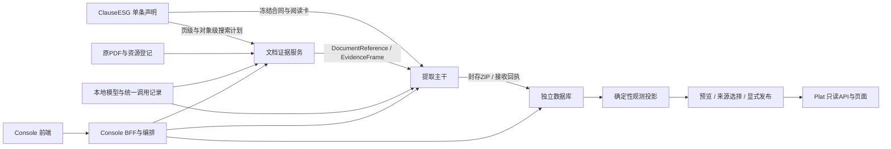

# 全链路文件级盘点、接口核验与完整性差距报告

审查日期：2026-11-01（Asia/Shanghai）。业务源码基线：`9c8b97aabbd7598b9fc673adc3a2d45323a6d443`。本次是只读审查与报告交付，不运行新提取、不修改条款/事实、不发布数据、不迁移数据库、不重启服务。

## 1. 判断与证据边界

**目前已经具备模块化工程主链，并用两个真实报告的局部任务完成“PDF → 原值 → 独立数据库接收 → 观测投影”。距离可以稳定扩展的完整产品，主要缺条款内容验收、代表性语料与标注、属性读取和语义正确性的系统验证、科学审核纠错闭环，以及真实非空发布和平台验收。** 不能把这些差距简化为继续拆目录或再增加几个接口。

本报告区分四种证据：

1. **本次源码核对**：文件职责、实际调用、合同校验、SQL和页面实现。
2. **本次运行核对**：HTTP GET、当前服务控制器、条款/报告/运行/投影目录和全部274条观测的资格统计。
3. **已有实际执行证据**：10月31日真实提取、隔离扫描派生页、安装版worker及回归结果；没有在本次重新推理。
4. **尚未证明**：全报告召回率、1113条全部科学准确、各种扫描报告适用、当前发布后的真实用户全流程、生产规模和跨环境部署。

文件清单覆盖基线中**1757个受管文件**：ClauseESG 1248、ExtractESG 286、ConsoleESG 53、database 65、PlatESG 32、docs 62、根文件4、tools 7。未读取保护区CrawlESG、私有配置和密钥。本轮新增报告自身不计入这个基线。

| 附件 | 用途 |
|---|---|
| [文件定位表](file-map.md) | 631个非单条声明文件的路径、角色、行数与符号位置 |
| [完整机器文件清单](file-inventory.json) | 全部1757文件的摘要、Python导入、类/函数及TS导出符号；包括每条clause.json |
| [1126条条款成熟度明细](clause-maturity.json) | 每条路径、类型、组织状态、样本数、词典字段、来源标识和内容复核标记 |
| [运行与数据状态](current-state.json) | 本次GET结果、18份PDF、两次任务、接收/投影、274条资格统计和IR限制 |
| [接口清单](interfaces.json) | 四个API进程实际OpenAPI注册的195个操作与静态路由声明；注册不等于写操作验收 |
| [接口定位表](interface-map.md) | 逐服务、逐方法、逐路径定位；动态注册另行说明 |
| [本次检查结果](checks.json) | 合同与生成类型、结构边界、文档链接检查；不冒充模型准确性评测 |

## 2. 当前总结构与实际进程



| 逻辑模块 | 拥有的内容 | 不应承担的内容 | 当前边界 |
|---|---|---|---|
| ClauseESG | 单条概念、定性/定量、词典、检索、阅读、用途、结果组织、证据和验收声明 | PDF解析、模型执行、数据库连接 | 独立SDK和目录；大组只展示，集合只选ID |
| Extract/contracts | 原值、开放属性、证据、期间、报告资源、端口/运行/交接DTO | 条款业务词、执行调度 | 轻量共享包；包含esg_contracts、esg_data、esg_reports |
| Extract/document | 原生文字、布局、必要OCR、IR、物理位置与证据能力 | ESG条款含义与事实发布 | 自有内部包与存储，通过证据端口供提取消费 |
| Extract/extraction | 一条搜索/阅读/绑定主干；按两类值分派 | 每个条款的专用词典、按条款ID分叉的引擎 | 消费ClauseRepository与DocumentPort/ModelPort/ArtifactPort |
| Extract/pipeline | PDF准备、冻结输入、排队、取消、进度与会话 | 条款定义与事实数值 | 调度层；当前组合与文档服务同进程 |
| shared_runtime | 执行锁、模型调用信封、进程、代码指纹、本机基础能力 | 科学定义与数据产品规则 | 独立基础包，被各模块消费 |
| Console | 报告/任务/条款/发布对象导航、状态BFF、桌面组合部署 | 在前端重算科学身份与SQL | 前端18081；BFF组合在18080 |
| database | ZIP接收、独立SQL、观测、选源、发布/撤下、科研表和来源保护 | 回扫提取产物目录、PDF解析 | 独立18280进程；Python接口+Node SQL执行 |
| Plat | 有效发布的数据集/观测/定义/来源/导出展示 | 原值写入、审核修改、数据库直连 | 8765；通过数据库HTTP和PDF散列端口读取 |

**逻辑解耦不等于每个目录一个微服务。** 当前五个受管服务均ready、均无待重启标记：数据库18280、提取18180、文档/Console18080、Plat8765、Console18081。`ConsoleESG/backend/src/esg_console/application.py`明确复用`esg_document.api.main.app`作为组合根；`ExtractESG/pyproject.toml`把document/pipeline/extraction打成同一个`esg-workbench`发行包。条款、共享合同、运行时和数据库SDK分别交付。当前不是五套完全独立环境都完成生产部署认证。

## 3. 按模块的文件级结构

下表是人工核对的关键责任文件。所有其余源码、测试、Schema、配置与文档逐文件列在[文件定位表](file-map.md)。文件位置以当前树为准，已删除的旧standards、foundation/standard双生产者、旧字典与旧SQL不再作为现行入口。

### 3.1 独立条款：ClauseESG

| 文件或模式 | 实际职责与状态 |
|---|---|
| [contract.py](../../../ClauseESG/src/esg_clauses/contract.py) | ClauseContract1.3；ValueContract与capture/enrichment/target_scope/comparison用途；摘要校验与reading_card。校验结构一致性，不鉴定标准含义 |
| [descriptor.py](../../../ClauseESG/src/esg_clauses/descriptor.py) | 结构描述1.0，不产生伪造的定性或定量值；可指向成员供导航 |
| [parts.py](../../../ClauseESG/src/esg_clauses/parts.py) | RetrievalProfile、ReadingContract、EvidenceRequirement、AcceptanceProfile、关系声明与规则枚举 |
| [reading.py](../../../ClauseESG/src/esg_clauses/reading.py) | 条款阅读规则解释器；通用及温室气体/污染物/水/废弃物算子。具体词来自本条；增加全新算子仍需扩展解释器并验证 |
| [search.py](../../../ClauseESG/src/esg_clauses/search.py) | 单条编译页/对象搜索计划；明确不适合页级执行的deferred字段；上下文词单独说明用途 |
| [evidence.py](../../../ClauseESG/src/esg_clauses/evidence.py) | 验证条款确认所需证据，产生缺失标记；不拒收独立原值 |
| [scope.py](../../../ClauseESG/src/esg_clauses/scope.py) | 期间、主体、方法、角色与范围枚举/匹配语义 |
| [repository.py](../../../ClauseESG/src/esg_clauses/repository.py) | 目录读取、索引、进程锁、摘要校验、冻结/解冻、原子保存和乐观并发 |
| [templates.py](../../../ClauseESG/src/esg_clauses/templates.py) | 新条款初始模板；生成模板不等于完成科学建设 |
| `clauses/<组>/<单条>/clause.json` | **唯一单条权威源**。1126条实际路径逐条见成熟度附件；不是一个全局Python词表 |
| `clauses/<组>/group.json` | 99个展示组的名称/说明；不决定提取路线 |
| [_catalog.json](../../../ClauseESG/clauses/_catalog.json) | 可重建索引，目录4.0；不是第二份科学定义 |
| [selections.json](../../../ClauseESG/clauses/selections.json) | base16/priority32/quantitative/universal/platform_major的ID选择集合，分别16/32/38/34/55条。quantitative集合名不代表全部281条定量 |
| [schemas](../../../ClauseESG/schemas) 与 [tests](../../../ClauseESG/tests) | 生成Schema、单条独立安装/冻结/目录一致性回归；不替代每条实报验收 |

**标准到底做完没有：容器、接口、独立性已形成，内容成熟度未完成。**

- 1126声明 = 281定量 + 832定性 + 13非执行结构描述；1113值条款均技术ready、0技术blocked。
- 1113值条款中，结果组织标记`sample`为32条、`template`为1081条。该字段只说明整理状态，不能把32条直接算作已科学验收。
- **条款内acceptance.samples非空的数量为0**。外部已有CATL/CKH benchmark，但尚未成为条款自身可查询、按摘要绑定的持续验收账本。
- 只有2条在organization字段中声明非空局部值词典；这不表示其他条款没有检索词，retrieval和reading词汇是另外两层。仍需核对主体、场址、方法、分项等真实属性如何编码与保留。
- 37条旧未决已做结构/定量/定性处置，13/9/15，内容复核仍声明`scientific_acceptance=not_evaluated`；“已分类”不能改称“实际提取验证通过”。
- provenance中共有199种`source_refs`符号ID，当前引用值无URI，仓库SDK未提供把这些ID解析为官方原文版本、页段和文件摘要的来源解析器。保留paragraph有用，但可追溯标准文本资产尚需补齐。
- 832条定性条款没有声明额外reading.rules；不能据此判定全部错误，但说明不能凭规则存在宣称已逐条验证细粒度语义。

### 3.2 共享原值、报告与交接合同

路径前缀：`ExtractESG/contracts/src/`。

| 文件 | 合同责任 |
|---|---|
| [data_kinds/quantitative.py](../../../ExtractESG/contracts/src/esg_contracts/data_kinds/quantitative.py) | 原始数字串必需；单位、结构化数、区间、比较符可缺；结构化元数据有问题时保留原值并记录未解析内容，不伪造精确值 |
| [data_kinds/qualitative.py](../../../ExtractESG/contracts/src/esg_contracts/data_kinds/qualitative.py) | 精确statement_raw必需；不能混入定量值字段；开放扩展注释 |
| [facts.py](../../../ExtractESG/contracts/src/esg_contracts/facts.py) | SourceFact2.0、ReportedField状态/字段证据、独立ClauseMapping、ClauseCoverage、预算与运行请求；wire kind为quantitative/assertion |
| [evidence.py](../../../ExtractESG/contracts/src/esg_contracts/evidence.py) | DocumentReference、SearchIntent、ObjectSearchPage、EvidenceFrame、行列/片段/位置结构 |
| [search.py](../../../ExtractESG/contracts/src/esg_contracts/search.py) | PDF页级搜索目标；条款摘要、完整词组和类型跨文档边界传递 |
| [results.py](../../../ExtractESG/contracts/src/esg_contracts/results.py) | FactBundle2.2；校验事实/映射/目标/统计一致；执行、搜索、原值、属性、比较资格分开 |
| [exports.py](../../../ExtractESG/contracts/src/esg_contracts/exports.py) | export1.1八个声明成员、散列、事实唯一权威；receipt1.0逐条处置与交付状态 |
| [sessions.py](../../../ExtractESG/contracts/src/esg_contracts/sessions.py) | PDF/IR输入、会话/原生运行、阶段和动作；一个请求选择单条IDs或命名集合 |
| [esg_data/organization.py](../../../ExtractESG/contracts/src/esg_data/organization.py) | 条款声明的结果字段/绑定、组织输出与矩阵合同；展示不能替代原值 |
| [esg_data/periods.py](../../../ExtractESG/contracts/src/esg_data/periods.py) | 年度/财年/季度/时点/区间/未知期间；实际测量期不从报告主年补造 |
| [esg_data/quantities.py](../../../ExtractESG/contracts/src/esg_data/quantities.py)、[units.py](../../../ExtractESG/contracts/src/esg_data/units.py)、[literals.py](../../../ExtractESG/contracts/src/esg_data/literals.py) | 数字/单位/字面量解释；保留原串，区分测量、年份、公式、编号等 |
| [esg_reports/contract.py](../../../ExtractESG/contracts/src/esg_reports/contract.py)、[repository.py](../../../ExtractESG/contracts/src/esg_reports/repository.py)、[importer.py](../../../ExtractESG/contracts/src/esg_reports/importer.py) | 原PDF稳定身份、批次manifest、元数据修订及导入；企业/发表年/主覆盖期不冒充事实身份 |

目前符合“有种类、量、单位就有地方放；丰富属性也有地方放”的核心方向。没有测量年、没有主体、没有单位，并不会被统一当成坏事实。必须继续保持的硬边界是：有真实测量或陈述、可回读的原值证据、不混造数据种类。缺属性与没有测量意义是两回事。

### 3.3 PDF、OCR、IR和证据服务

路径前缀：`ExtractESG/document/src/esg_document/`。

| 文件/文件簇 | 实际责任与需留意的边界 |
|---|---|
| [api/main.py](../../../ExtractESG/document/src/esg_document/api/main.py) | 18080文档应用主体，1425行；组装模型、存储、队列、OCR/IR、资源与诊断路由，仍是集中维护点 |
| [api/report_resources.py](../../../ExtractESG/document/src/esg_document/api/report_resources.py)、[assets/report_catalog.py](../../../ExtractESG/document/src/esg_document/assets/report_catalog.py) | 规范PDF资源读取/上传/批次导入/编辑；物理资产与业务资源分别管理 |
| [ocr/pdf_preflight.py](../../../ExtractESG/document/src/esg_document/ocr/pdf_preflight.py) | 必要PDF规范化，保留原件与转换血缘 |
| [ocr/page_selection.py](../../../ExtractESG/document/src/esg_document/ocr/page_selection.py) | 接收条款搜索目标，先原生文字选页；扫描/不可读回退相应能力；不再固定17组业务词 |
| [ocr/text_layer.py](../../../ExtractESG/document/src/esg_document/ocr/text_layer.py)、[vision_prescan.py](../../../ExtractESG/document/src/esg_document/ocr/vision_prescan.py)、[vision_ocr.swift](../../../ExtractESG/document/src/esg_document/ocr/vision_ocr.swift) | 原生字层与系统Vision预扫描/局部字；非条款语义理解 |
| [ocr/providers.py](../../../ExtractESG/document/src/esg_document/ocr/providers.py)、[local_worker.py](../../../ExtractESG/document/src/esg_document/ocr/local_worker.py)、[client.py](../../../ExtractESG/document/src/esg_document/ocr/client.py) | 实际本地Paddle/布局路由、独立进程和执行记录；默认禁止云OCR |
| [document/layout_extractor.py](../../../ExtractESG/document/src/esg_document/document/layout_extractor.py)、[paddleocr_converter.py](../../../ExtractESG/document/src/esg_document/document/paddleocr_converter.py)、[parser_fusion.py](../../../ExtractESG/document/src/esg_document/document/parser_fusion.py) | 布局、OCR原输出转换与物理融合 |
| [document/contracts.py](../../../ExtractESG/document/src/esg_document/document/contracts.py)、[reader.py](../../../ExtractESG/document/src/esg_document/document/reader.py)、[writer.py](../../../ExtractESG/document/src/esg_document/document/writer.py) | IR内部对象模型与包读写；不是数据库原值接收合同 |
| [document/physical.py](../../../ExtractESG/document/src/esg_document/document/physical.py)、[table_geometry_resolver.py](../../../ExtractESG/document/src/esg_document/document/table_geometry_resolver.py)、[logical_table_builder.py](../../../ExtractESG/document/src/esg_document/document/logical_table_builder.py) | 物理表格、几何、结构/逻辑表解释 |
| [document/spread_builder.py](../../../ExtractESG/document/src/esg_document/document/spread_builder.py)、[spread_pair_analysis.py](../../../ExtractESG/document/src/esg_document/document/spread_pair_analysis.py) | 横向/跨页宽表的统一对齐与来源；不能由提取端再造另一套表 |
| [document/evidence_service.py](../../../ExtractESG/document/src/esg_document/document/evidence_service.py)、[api/evidence.py](../../../ExtractESG/document/src/esg_document/api/evidence.py) | 文档引用、词项排序、分页搜索、帧读取；绑定版本与query_digest |
| [document/evidence_capabilities.py](../../../ExtractESG/document/src/esg_document/document/evidence_capabilities.py)、[quality_router.py](../../../ExtractESG/document/src/esg_document/document/quality_router.py) | 对象/页能力与有限证据策略，缺一个图不应整体阻塞可用表 |
| [document/operation_registry.py](../../../ExtractESG/document/src/esg_document/document/operation_registry.py)、[review_orchestrator.py](../../../ExtractESG/document/src/esg_document/document/review_orchestrator.py)、[patch_guard.py](../../../ExtractESG/document/src/esg_document/document/patch_guard.py)、[validator.py](../../../ExtractESG/document/src/esg_document/document/validator.py) | IR审查、受控补丁、事务/验证。**这是物理文档修复，不是ESG科学事实审核** |
| [storage/package_layout.py](../../../ExtractESG/document/src/esg_document/storage/package_layout.py)、[package_validator.py](../../../ExtractESG/document/src/esg_document/storage/package_validator.py)、[ir_retention.py](../../../ExtractESG/document/src/esg_document/storage/ir_retention.py) | 文档内部产物布局、完整性和保留策略 |
| [assets/library_deletion.py](../../../ExtractESG/document/src/esg_document/assets/library_deletion.py) | 来源引用、取消/清理协调、删除保护；不得把清理当作科学问题修复 |

当前生产保留2个OCR包和2个IR包。CATL原件92页，选择18页；CKH原件209页，选择9页。两个IR作业均为partial/auto_review_pending，可用有限证据分别18页/8页：CATL排除1个figure；CKH排除1个figure及物理第171页。提取仍可完成，这正是“可用局部继续、限制如实表达”的策略；不能改称完整报告已解析和读完。

### 3.4 提取主干、搜索和模型调用

路径前缀：`ExtractESG/extraction/src/esg_extraction/`。

| 文件 | 实际执行内容 |
|---|---|
| [pipeline/api.py](../../../ExtractESG/extraction/src/esg_extraction/pipeline/api.py) | 条款、阅读卡/组织、校验/保存、冻结、预览、运行、事实、组织结果和封存导出API |
| [pipeline/runtime.py](../../../ExtractESG/extraction/src/esg_extraction/pipeline/runtime.py)、[state.py](../../../ExtractESG/extraction/src/esg_extraction/pipeline/state.py)、[worker.py](../../../ExtractESG/extraction/src/esg_extraction/pipeline/worker.py) | 运行目录/状态、实际worker、队列执行锁、完成封存/交付 |
| [pipeline/ports.py](../../../ExtractESG/extraction/src/esg_extraction/pipeline/ports.py) | 三个Protocol：DocumentPort.document/search_page/read，ModelPort.complete，ArtifactPort.write |
| [pipeline/engine.py](../../../ExtractESG/extraction/src/esg_extraction/pipeline/engine.py) | 逐条冻结合同→检索→读取→两类局部模型决策→确定性绑定→关系/范围→事实/组织输出；主干版本1.3 |
| [pipeline/retrieval.py](../../../ExtractESG/extraction/src/esg_extraction/pipeline/retrieval.py) | 候选分页、总数、游标、查询一致性、预算截断；不会静默把第一页当全部 |
| [pipeline/structure.py](../../../ExtractESG/extraction/src/esg_extraction/pipeline/structure.py)、[period_binding.py](../../../ExtractESG/extraction/src/esg_extraction/pipeline/period_binding.py) | 物理列语义与期间绑定，各年份分别保存；没有主年筛掉历史列 |
| [pipeline/reading_frame.py](../../../ExtractESG/extraction/src/esg_extraction/pipeline/reading_frame.py)、[frames.py](../../../ExtractESG/extraction/src/esg_extraction/pipeline/frames.py) | 紧凑模型输入、短ID和预算分块；完整物理帧另存供绑定 |
| [pipeline/decisions.py](../../../ExtractESG/extraction/src/esg_extraction/pipeline/decisions.py) | 定量/定性决策Schema，限制模型引用可用行列/span，而不是让模型生成事实数值 |
| [pipeline/binding.py](../../../ExtractESG/extraction/src/esg_extraction/pipeline/binding.py) | 回读真实单元格/原文、字段quote校验、原值合同、范围/比较标记；阅读拒绝改变目标关系，真实原值仍保留 |
| [pipeline/organization.py](../../../ExtractESG/extraction/src/esg_extraction/pipeline/organization.py) | 执行单条organization字段绑定、结果表/矩阵；不自动求和 |
| [pipeline/exporting.py](../../../ExtractESG/extraction/src/esg_extraction/pipeline/exporting.py)、[delivery.py](../../../ExtractESG/extraction/src/esg_extraction/pipeline/delivery.py) | 封存八成员、ZIP、散列；自动outbox、幂等回执、失败状态和重试 |
| [pipeline/adapters/document.py](../../../ExtractESG/extraction/src/esg_extraction/pipeline/adapters/document.py)、[artifacts.py](../../../ExtractESG/extraction/src/esg_extraction/pipeline/adapters/artifacts.py) | HTTP文档端口与私有产物存储；数据库不依赖其目录布局 |
| [pipeline/adapters/local_model.py](../../../ExtractESG/extraction/src/esg_extraction/pipeline/adapters/local_model.py)、[models/mlx_runtime.py](../../../ExtractESG/extraction/src/esg_extraction/models/mlx_runtime.py)、[schema_decoding.py](../../../ExtractESG/extraction/src/esg_extraction/models/schema_decoding.py) | 实际本地Qwen、MLX预算/生成、结构化约束与调用记录 |
| [tests/fixtures/scientific](../../../ExtractESG/extraction/tests/fixtures/scientific)、[evaluate_scientific.py](../../../ExtractESG/scripts/evaluate_scientific.py) | CATL/CKH空气排放逐值标注与评测入口；目前并非全条款金标库 |

搜索生产路径已经真实消费单条合同：`ExtractionCoordinator.tick`编译页目标送入PDF准备；`engine.run`再次编译对象目标，`DocumentEvidenceService.search_page`按正词、精确词、词组、结构、上下文和来源优先级排序。当前是词项检索，**没有生产embedding调用**。负词通常降低混合对象优先级，明确对象排除才剔除对象。

上下文词确实用于页级supporting terms及对象评分；但当前没有“量值找到后，再独立检索主体/边界/方法并判定适用范围”的完整补充阶段。engine只遍历plan.objects候选。`expected_candidate_types`的实际排序收益也有限，当前可见正文percentage加权，不能将每个声明项都称作完整语义过滤器。应做合同字段—消费者—效果测试的覆盖矩阵。

### 3.5 编排、共享运行时与部署

| 文件 | 当前责任 |
|---|---|
| [pipeline/extraction.py](../../../ExtractESG/pipeline/src/esg_pipeline/extraction.py) | ExtractionCoordinator：PDF/IR统一请求、预览与合同/引擎摘要、submission_key幂等、准备完成后排提取、取消、状态观察 |
| [pipeline/report_processing.py](../../../ExtractESG/pipeline/src/esg_pipeline/report_processing.py) | OCR→IR准备计划、可复用物理产物、质量/范围评估；1397行集中状态逻辑 |
| [pipeline/store.py](../../../ExtractESG/pipeline/src/esg_pipeline/store.py)、[scheduler.py](../../../ExtractESG/pipeline/src/esg_pipeline/scheduler.py)、[worker.py](../../../ExtractESG/pipeline/src/esg_pipeline/worker.py) | 控制记录、全局队列、超时/取消/派工；不是观测数据库 |
| [pipeline/native_dispatch.py](../../../ExtractESG/pipeline/src/esg_pipeline/native_dispatch.py)、[execution_api.py](../../../ExtractESG/pipeline/src/esg_pipeline/execution_api.py)、[source_references.py](../../../ExtractESG/pipeline/src/esg_pipeline/source_references.py) | 原生任务桥、队列控制与来源引用协调 |
| [runtime/model_calls.py](../../../ExtractESG/shared_runtime/src/esg_runtime/model_calls.py) | 模型任务/尝试、证据ID、模态、prompt/schema摘要、申请/有效预算、tokens、耗时与校验结果 |
| [runtime/execution_slot.py](../../../ExtractESG/shared_runtime/src/esg_runtime/execution_slot.py) | 队列与worker继承同一执行锁，避免模型绕队列并发 |
| [runtime/release.py](../../../ExtractESG/shared_runtime/src/esg_runtime/release.py)、[layout.py](../../../ExtractESG/shared_runtime/src/esg_runtime/layout.py) | 实际包内容指纹、运行/数据根配置；不拿checkout绝对路径作为科学版本 |
| [Console scripts/workbench.py](../../../ConsoleESG/scripts/workbench.py)、[start.sh](../../../ConsoleESG/scripts/start.sh)、[run_service.sh](../../../ConsoleESG/scripts/run_service.sh) | 五服务启动/状态/停止/重启及本地生命周期；只检查已初始化数据库 |
| [install_local.sh](../../../ConsoleESG/scripts/install_local.sh)、[install_worker.py](../../../ConsoleESG/scripts/install_worker.py)、[verify_standalone.py](../../../tools/verify_standalone.py)、[verify_worker.py](../../../tools/verify_worker.py) | wheel安装、两类模型Python更新、源码外SDK/worker验证 |

Qwen3.5-9B-4bit负责当前条款语义，实际输入是文字帧；PP-DocLayoutV3负责布局，PaddleOCR-VL1.6负责必要识别，系统Vision负责预扫描/局部字。可选NuExtract和显式远程适配器不等于生产已使用。温度0和grammar约束有助结构稳定，不能证明量值属于正确主体、段落真正回答条款。

没有跨条款/跨运行语义理解缓存；同一PDF按处理计划/代码版本匹配的物理OCR/IR仍可复用。权重驻留与物理复用不应误删。

### 3.6 Console前后端

| 文件 | 页面/接口责任与状态 |
|---|---|
| [backend/application.py](../../../ConsoleESG/backend/src/esg_console/application.py) | 本机组合根，接文档应用、ExtractionCoordinator及数据库ProductClient |
| [backend/sessions.py](../../../ConsoleESG/backend/src/esg_console/sessions.py) | report-sessions、统一console/monitor、事实/组织代理、产品状态、归档与恢复 |
| [backend/monitor.py](../../../ConsoleESG/backend/src/esg_console/monitor.py)、[products.py](../../../ConsoleESG/backend/src/esg_console/products.py) | 同一后端运行视图与接收/投影/发布阶段条；连接失败不伪造执行结束 |
| [app/App.tsx](../../../ConsoleESG/frontend/src/app/App.tsx)、[routes.ts](../../../ConsoleESG/frontend/src/app/routes.ts) | 报告、提取、条款、发布、运行五入口及父子路由 |
| [reports/pages.tsx](../../../ConsoleESG/frontend/src/features/reports/pages.tsx)、[dialogs.tsx](../../../ConsoleESG/frontend/src/features/reports/dialogs.tsx) | 报告列表/详情、上传、批次导入、资源元数据、清理操作 |
| [clauses/pages.tsx](../../../ConsoleESG/frontend/src/features/clauses/pages.tsx)、[editor.tsx](../../../ConsoleESG/frontend/src/features/clauses/editor.tsx) | 组→单条列表→细节，独立新增/编辑弹窗、返回；复杂组织与全合同仍使用JSON编辑 |
| [extractions/create.tsx](../../../ConsoleESG/frontend/src/features/extractions/create.tsx)、[list.tsx](../../../ConsoleESG/frontend/src/features/extractions/list.tsx) | 统一单/多报告选择、独立条款选择、预览、批量逐报告提交与任务列表 |
| [extractions/detail.tsx](../../../ConsoleESG/frontend/src/features/extractions/detail.tsx)、[results.tsx](../../../ConsoleESG/frontend/src/features/extractions/results.tsx) | 任务→条款表→独立事实；原值、属性、候选、覆盖、证据弹窗与PDF页链接 |
| [runtime/monitor.tsx](../../../ConsoleESG/frontend/src/features/runtime/monitor.tsx)、[pages.tsx](../../../ConsoleESG/frontend/src/features/runtime/pages.tsx) | 常驻可展开/固定运行浮窗、阶段/事实/模型状态及高级运行详情；不是各页各算next_action |
| [publication/data.tsx](../../../ConsoleESG/frontend/src/features/publication/data.tsx)、[observations.tsx](../../../ConsoleESG/frontend/src/features/publication/observations.tsx) | 接收/投影状态、分页观测、重试与科研下载 |
| [publication/create.tsx](../../../ConsoleESG/frontend/src/features/publication/create.tsx)、[pages.tsx](../../../ConsoleESG/frontend/src/features/publication/pages.tsx) | 来源策略、实际成员预览、显式理由、发布/撤下及数据集详情 |
| [shared/api.ts](../../../ConsoleESG/frontend/src/shared/api.ts)、[resource.ts](../../../ConsoleESG/frontend/src/shared/resource.ts)、[ui.tsx](../../../ConsoleESG/frontend/src/shared/ui.tsx)、[contracts.ts](../../../ConsoleESG/frontend/src/shared/contracts.ts) | 同源三服务代理、请求/观察状态、通用Modal、生成DTO类型 |
| [styles.css](../../../ConsoleESG/frontend/src/styles.css) | 当前交互与样式；1733行单文件，视觉回归与模块维护仍需后续治理 |

前端已经有层级页、统一浮窗和表格，不应再把这些列成“完全未做”。不足是：条款内容成熟度/来源文本缺少业务呈现；科学审核动作尚无独立闭环；基础FactsTable未直接列期间（可在组织表和事实详情查看），多年份日常核对仍可改善；完整事实/组织集合的前端加载不适合无限增长。当前无本次浏览器视觉验收，不以组件测试代替截图/交互验证。

### 3.7 独立数据库与Plat

| 文件 | 实际责任 |
|---|---|
| [database/api.py](../../../database/src/esg_database/api.py)、[ingestion.py](../../../database/src/esg_database/ingestion.py) | 接收ZIP、成员/散列/合同校验、回执与事实分页；不运行提取模型 |
| [database/contracts.py](../../../database/src/esg_database/contracts.py)、[products_contracts.py](../../../database/src/esg_database/products_contracts.py)、[source_contracts.py](../../../database/src/esg_database/source_contracts.py) | 接收、观测/发布、来源保护DTO，生成Python/TS/Schema共享接口 |
| [projection.py](../../../database/src/esg_database/projection.py)、[projector.py](../../../database/src/esg_database/projector.py) | 冻结条款+原值确定性观测、期间、关系、资格/比较键；后台状态、失败与重试 |
| [selection.py](../../../database/src/esg_database/selection.py) | 全来源/最新报告/明确重述的预览与成员决定；不自动求和、不按上传时间覆盖 |
| [products_api.py](../../../database/src/esg_database/products_api.py) | 内部观测、预览/发布/撤下、公开v2、科研导出 |
| [research.py](../../../database/src/esg_database/research.py) | 六张科研长表、definitions/manifest、CSV/精确Parquet；容量上限明确 |
| [sources_api.py](../../../database/src/esg_database/sources_api.py)、[operator.py](../../../database/src/esg_database/operator.py) | 删除/入库来源事务协调，本机同源操作者写控制 |
| [runtime/rpc.mjs](../../../database/runtime/rpc.mjs)、[capture_worker.mjs](../../../database/runtime/capture_worker.mjs)、[connection.mjs](../../../database/runtime/connection.mjs) | Python→Node命令协议、独立SQL连接；本地PGlite或显式PostgreSQL |
| [queries/ingestion.mjs](../../../database/queries/ingestion.mjs)、[captures.mjs](../../../database/queries/captures.mjs) | 原值/属性/证据/条款冻结的事务入库与查询 |
| [capture_products.mjs](../../../database/queries/capture_products.mjs)、[capture_publication.mjs](../../../database/queries/capture_publication.mjs)、[capture_workflow.mjs](../../../database/queries/capture_workflow.mjs)、[capture_sources.mjs](../../../database/queries/capture_sources.mjs) | 投影/观测、成员/发布事件、工作流状态、来源引用/预留 |
| [runtime/schema.mjs](../../../database/runtime/schema.mjs)、[manage.mjs](../../../database/runtime/manage.mjs) | 迁移摘要与就绪；仅显式init安装，服务启动不迁移、不接管旧表 |
| [0019](../../../database/migrations/0019_capture_ingestion.sql)、[0020](../../../database/migrations/capture/0020_products.sql)、[0021](../../../database/migrations/capture/0021_source_lifecycle.sql) | 当前原值、产品、来源保护19张业务表；另有迁移账本，不恢复旧数据库体系 |
| [http_client.py](../../../database/src/esg_database/http_client.py)、[contracts/index.d.ts](../../../database/contracts/index.d.ts) | Console/Plat消费的窄HTTP客户端与生成类型；不是SQLSDK |
| [Plat backend/main.py](../../../PlatESG/backend/main.py)、[products.py](../../../PlatESG/backend/products.py) | 只读v2、服务/产品就绪、旧接口410；不承担审核写入 |
| [evidence_resolver.py](../../../PlatESG/backend/evidence_resolver.py) | 按PDF SHA经文档HTTP取原件并校验，不读提取目录 |
| [PublishedData.tsx](../../../PlatESG/frontend/src/components/PublishedData.tsx)、[AppShell.tsx](../../../PlatESG/frontend/src/components/AppShell.tsx)、[ProductLink.tsx](../../../PlatESG/frontend/src/components/ProductLink.tsx) | 数据集→观测→证据，期间/条款/关系过滤与CSV/Parquet下载 |

原值层7表：exports、captured_facts、export_facts、clause_targets、clause_relations、properties、evidence；产品层10表：projection_attempts、projections、definitions、observations、projection_members、restatements、dataset_versions、dataset_projections、dataset_members、dataset_events；来源保护2表：locks、reservations。完整实际表名见文件清单中的tables字段。

Plat目前的明确产品形态是**已发布原值/观测浏览与科研数据下载**。跨企业趋势、统一单位计算、行业对比、跨条款版本概念对齐、派生强度/聚合分析没有在当前页面/接口中形成完整产品。声明canonical_unit/aggregation不等于当前链路已自动换算/求和。

## 4. 合同与接口状态核对

### 4.1 合同主次

| 边界 | 当前合同 | 权威来源与消费者 |
|---|---|---|
| 单条与结构说明 | clause1.3 / descriptor1.0 / catalog4.0 | ClauseESG单条；前端、搜索、阅读、组织、投影冻结定义共同消费 |
| 两类值 | quantitative / qualitative | contracts/data_kinds；SourceFact wire值为quantitative/assertion |
| 事实与目标关系 | SourceFact2.0 / ClauseMapping / Coverage | 提取绑定；接收/投影保留原值、证据和目标关系，不把关系混成事实值 |
| 物理证据 | DocumentReference / EvidenceFrame / ObjectSearchPage1.0 | document提供，extraction经端口读取；IR内部模型版本独立 |
| 结果集合/展示 | FactBundle2.2 / organized1.1 | facts权威、组织可重建；没有把矩阵单元格当正式入库事实 |
| 服务交接 | export1.1 / receipt1.0 | producer封存、database验证/回执；无生产者绝对目录要求 |
| 产品 | observation1.0 / projection1.0 / dataset-version1.0 / source-selection1.0 | database确定性生成；Console控制、Plat只读 |
| 报告资源 | resource1.0 / batch1.0 | PDF身份与元数据；不能替代测量期/实际统计主体 |

本次`tools/check_contracts.py`通过：1126条/1113值/13结构、0blocked，17份检查入口Schema、30个Console生成模型、18个数据库生成模型一致。17是该检查器负责的合同集合数量，不是整个仓库所有JSON Schema文件总数。

### 4.2 进程与有效API

| 服务 | 当前OpenAPI路径/操作数 | 本次实测 | 关键接口 |
|---|---:|---|---|
| 18080 文档+Console | 114 / 124 | 健康、资源、会话、浮窗、OCR/IR目录均200 | report-resources、report-sessions、console/monitor、evidence、report-processing、pipeline/tasks |
| 18180 条款+提取 | 27 / 29 | 健康、条款、运行、引擎200 | clauses及template/validate/PUT、targets/freeze、runs及facts/organized/exports |
| 18280 独立数据库 | 30 / 32 | 健康、投影、观测、数据集目录200 | ingestion/exports/receipts、projections、datasets/preview/publish/withdraw、restatements、sources/lifecycle、公开v2 |
| 8765 Plat | 10 / 10 | 健康、公开目录200；旧v1/internal/review实测410 | v2/datasets及observations/definitions/sources/export、sources/{sha}/pdf |
| 18081 Console | 静态页+同源代理，不用OpenAPI计数 | 控制器ready | /document、/extraction、/database三个服务前缀 |

195是四个API进程的注册操作总数，不是195条都已完成本次端到端测试。写操作只核对代码和已有隔离/历史执行证据，本次没有调用发布、撤下、编辑、清理或提取创建。410兜底中部分故意不在OpenAPI展示。文档高级诊断接口仍多，业务主界面已收敛；不能机械按数量删掉有用的OCR/IR诊断能力。

### 4.3 一份报告的实际数据与状态走向

1. 上传/批次登记：原PDF SHA稳定，资源信息单独修订。
2. Console预览：单条选择冻结摘要和引擎指纹；批量仍是多个独立报告会话。
3. Coordinator从冻结单条生成页级搜索；文档先原生字/布局，必要时本地OCR，产生有限或完整IR。
4. engine按单条对象计划定位，取得带版本/物理来源的帧；按预算分块。
5. Qwen只输出行列/span和证据支持的属性；绑定器回读取值。2023/2024/2025各留一条，未知期间也可保留。
6. 原值、目标关系、范围覆盖、属性、比较资格分别记录；候选非测量另留诊断。
7. 完成后facts唯一权威封存为8成员：facts、properties、evidence、relations、coverage、targets、document、diagnostics；outbox自动交付、按摘要核对回执。
8. database原值接收独立成功；后台确定性投影。投影失败不撤销原值，前端仍可浏览和下载原值。
9. Console查看观测/定义/来源，选策略及实际成员，显式发布。此步骤目前有发布操作核对，尚缺完整科学审核账本。
10. Plat仅消费有效发布；撤下后公开读取停止，原始事实仍留数据库。

## 5. 当前真实资产、执行结果与限制

### 5.1 PDF库与样本缺口

现有18份资源，原件全部可用、企业信息18/18；主覆盖年分布2025年12份、2024年3份、2026/2020/2019各1份。**发表年0/18、行业0/18**。这只是资源声明，不能从主覆盖年推导发表年，更不能据此怀疑或确认PDF内部年份。

18份原PDF合计约470MB；blobs目录另有一个SQLite控制文件，因此“目录19个文件”不应写成19份报告。当前2份有保留的OCR/IR及实际提取，不等于其余16份已证明不可用；它们尚缺当前主干的系统验证。

需要增加的不是同版式PDF数量，而是**分层覆盖**：中文/英文/繁体、制造/能源/金融/地产/综合集团等行业、原生/原始扫描/混合文本、窄表/横向宽表/跨页表/正文、稀疏身份/多子公司/多范围、季度/财年/累计/目标/基期/重述、零/范围/百分比/未解析数字以及真实不披露反例。已有受控扫描页不代表真实扫描全报告。

### 5.2 两次真实任务

| 结果 | CATL 2025报告 | CKH报告 |
|---|---:|---:|
| 当前运行状态 | completed | completed |
| 选择条款 | E2-4_02、E2-4_09 | E2-4_02 |
| 产出 | 51定量+1定性=52 | 222定量 |
| 期间 | 2023:15，2024:18，2025:18，未知:1 | 2023:75，2024:75，2025:72 |
| 本目标 / 其他目标 | 10 / 42 | 45 / 177 |
| 模型调用 / 主干耗时 | 10 / 956.513秒 | 2 / 291.196秒 |
| 原值接收 | 52接受、0拒收 | 222接受、0拒收 |
| 观测投影 | 52 | 222 |
| 自动比较eligible / 有comparison_key | 0 / 0 | 0 / 0 |
| 已标注逐值核对范围 | 9个空气量值 | 45个空气量值 |

耗时是运行summary中的主干耗时，不含用户等待及全部文档准备；不能将两个不同报告的耗时直接解释为某优化的提速比例。

两个真实报告共54个已标注目标量值回归通过；不等于274条每一条都完成科学判读。CATL额外定性段落有原文锚，但是否充分回答“测量方法”仍需人工语义验收。42/177条different是同候选对象保留的其他真实量，不应算作“本条目标全提取错误”或在展示中不加区分。

此前隔离单页扫描派生试验：本地Paddle+Qwen生成51定量，9个目标标注通过并接收/投影；它是原页栅格化的受控派生，不是新增原始扫描报告，也没有登记为第19份资源。参见[既有执行证据](../../implementation/2026-10-31/README.md)。

### 5.3 为什么有原值但比较资格仍为0

本次逐条读取数据库观测后的实际统计：

- CATL 51条定量均缺实际统计主体、实际边界和pollution_medium的已确认来源；42条其他目标另有pollutant缺失；52条均存在declared_scopes_unconfirmed。
- CKH 222条均缺实际统计主体和pollution_medium；219条缺已确认边界，只有3条边界取得；222条均存在declared_scopes_unconfirmed。
- 52/222条quality均grounded。这表示有回读原值/陈述来源，**不表示模型语义已由人审核正确**。
- 数据库来源信息的发表年仍全部未知。`latest_report`即使启用，也会保留身份不完整或发表年未知的来源，不会凭上传时间自动挑新值。

部分属性可能原报告没有，部分可能有而未读到；只凭“未知”统计不能把两者混为一类。当前缺少对“报告有属性但链路漏读”的标注与适用范围验证。修复方向是证据驱动的上下文补读和明确“原文未说明/未搜索/已查无可靠证据”的状态，而不是把资源企业、条款fixed_axes或主年份硬填入事实。

### 5.4 回归与部署证据的适用范围

10月31日已有665项Python、Console19项、Plat前端7项、数据库Node9项通过记录；本次没有重新运行这组全量回归。此次重新执行的是合同/生成类型、结构边界和文档检查，并重新读取实际服务及当前数据。不能把测试数量当成条款科学准确率。

[源码外安装验证](../../verification/standalone.json)证明SDK/application wheel与独立数据库资产可以脱离提取checkout；[安装版worker验证](../../verification/installed-worker.json)使用显式空的合成DocumentPort、0事实、0模型调用，证明入口/队列锁/封存能运行，不证明模型读取真实PDF的准确性。

当前引擎指纹为`db65813affab94bef289f401ef86b4eb31da5e3a1d857427ebcf2f33d436cb81`；两次真实业务运行保留当时的`cabd7bc8016fe289978f9f2b21a6cc9aa5d497c14afaff0a1d4ca4116c565ba7`。后续安装/执行基础设施修复没有被冒称为两份报告在最新指纹下重新推理；未来效果回归需要按实际版本重跑。

## 6. 距离完整链路的具体差距与改进

### P0-1 条款科学成熟度、来源和验收没有形成可执行闭环

**证据：** 全部acceptance.samples为空；1081条组织模板；199种来源符号没有SDK解析；publish_dataset核对成员摘要/理由，没有消费按条款摘要绑定的科学验收结论。

**影响：** ready代表能执行，当前无法回答“哪些条款在何种报告上达到什么可信程度”。模板条款可被选择，当前发布条件也不等同于“该条款已经科学验收”。

**落点：** ClauseESG的provenance、AcceptanceProfile、repository与templates；新增标准文本来源解析/证据资产和可重跑评测账本。Console条款详情只呈现内容等级、适用样本、失败边界和来源，不恢复历史包堆砌。数据库冻结随发布采用的验收摘要，不能事后改写旧产品。

**验收：** 先完成用户实际要用的一组32条，而不是虚报1113条完成；每条有定义/排除/单位与角色/检索和属性声明、可查官方文本版本、至少跨2份有披露报告的实跑、至少1个混淆或不适用反例；定性逐句核对回答充分性。技术ready与内容等级独立；没有样本也可试跑/接收原值，生产发布是否允许必须显式表达，不能隐式当已验证。

### P0-2 科学审核与纠错尚未成为独立产品闭环

**证据：** 当前SQL产品表记录发布/撤下/重述，但没有逐事实/逐字段的审核决定合同与账本；现有UI主要是查看证据、再次选择提取、成员预览。IR的patch/review只修文档。

**改进：** 增加独立审核决定，引用原始fact/字段路径/条款摘要/实际证据，记录接受、拒绝、需补读、标注修正及理由；不覆盖原值。量值错误回到IR/绑定修复重跑，语义/属性修正形成带来源的修订解释或新产品版本。发布可以消费所需审核决定，允许未知可选属性，不能借“审核”重新强制所有维度。

**落点：** contracts新增审核DTO；database新增不可变决定/修订引用；Console事实/条款结果子页提供聚焦动作；发布预览显示采用的决定。Plat只读采用结果，无审核写入口。

**验收：** 完整演示一条误匹配、一条漏属性、一条真实未知、一条错位单元格从发现到重跑/修订、再到新发布；旧原值与旧发布含义不变。单纯点击发布并填理由不能算科学审核验收。

### P1-1 代表性PDF、标注与评测矩阵不足

**改进：** 把18份现有资源先做分层档案，补可查发表年/行业和来源（可缺，不阻塞入库）；再按缺失版式与语言采购/收集原件。建议第一批30–50份代表性原报告是规划量，不是现有数，也不是足够泛化的统计证明；其中应包括真实扫描和中英宽表。每份固定所选条款、目标页/对象、应有量值/陈述及负例，不只记录程序产出。

**落点：** esg_reports合同与导入、评测fixtures/evaluate_scientific、独立语料manifest和可重跑评测工具。

**验收：** 单独报告页召回、对象召回、目标关系精确率/召回率、原串/单位/期间正确率、属性有则保留率、定性回答充分性、耗时/tokens；不知道真实分母时不写全报告召回百分比。全报告标注与局部标注分别计分。

### P1-2 搜索与证据范围仍需补充，而不是恢复理解缓存

**证据：** CATL18/92页、CKH9/209页；IR有限；对象搜索有总数/预算但当前仅词项，context主要参与选页和排序，没有完整独立属性补读。

**改进：** 建立“合同字段→页级/对象级/补充证据消费者”的覆盖测试；针对标注漏召回扩词与词组；量值读到后按条款请求的缺失属性定向搜索，证据的适用对象/时期必须判定，不能报告级字符串到处继承。必要复杂图/页修复只对需要的对象触发。是否加向量检索由对照实验决定，不先添加基础设施。

**验收：** 新条款不改引擎词表；查不到要能区分预算未覆盖、候选未找到、未读成功和读完仍无证据；`bounded_complete`始终指计划内完成。禁用跨条款/跨运行语义复用的用户要求继续有效。

### P1-3 模型效果与性能缺少可比较基线

**证据：** CATL10次/约15.9分钟与输出截断/分块重试；CKH2次/约4.9分钟。受约束JSON能回读引用，但不能保证每个匹配和属性适用范围正确。

**改进：** 保持两类通用提示、单条语义来源；优先把已确定列/期间和共享身份留在结构层，减少模型重复identity；按对象大小/剩余预算切帧。分开统计准备、加载、输入、生成、绑定和交付。用固定样本比较帧尺寸、预算、提示和可选本地模型；不静默切云。

**验收：** 同一语料与目标集同时对比准确/召回/属性保留、失败/截断率、tokens、端到端与p50/p95时延、内存；先保正确性再决定配置。既有受控页55.864秒不能当完整报告性能。

### P1-4 原值完成后到正式平台展示还缺非空业务验收

**证据：** live两投影274观测，内部/公开数据集均0。代码和隔离测试有发布/撤下，不等于本机当前用户数据完成公开链路验收。

**改进与验收：** 先审定一组真实观测、核对成员和来源，再由用户明确发布；按数据集目录→详情→多期间过滤→定性/定量→字段证据→原PDF→CSV/Parquet读回→撤下验证整条操作。保留自动发布关闭；本次审查不代替用户发布决定。

### P1-5 比较与数据产品规则应继续与原值准入分离

当前comparison按冻结用途、范围、来源身份判资格，保守有理由；但两次实跑0合格说明上游属性/范围读取及比较政策需要专门验证。所有源必须齐全还是逐观测足够，应由产品用途明确，不应因本条其他范围未找到而含混否定已证实的一个成员。

**落点：** ClausePurposes.comparison、binding的scope、projection与selection；增加“支持该观测的范围证据”与“整条披露完整度”的清晰关系。不能通过默认集团、默认actual、默认年度、条款固定medium覆盖未知来换取eligible。

**验收：** 稀疏原值继续可接收/下载；属性有证据的行能单独解释比较资格；相同主体/期间/单位/定义且发表年有据时latest_report实际选源；未知身份保留多源；不同单位/边界/主体不错误合并。跨版本概念等价与单位转换先作显式独立产品，不改原值。

### P2-1 Console交互与大结果量

保持现有父子页、独立新增窗口、浮窗与条款表。补条款内容成熟度/来源入口、科学审核动作、raw事实列表期间列；默认把match/uncertain/different分区表达清楚，避免把52/222当全部属于目标。将全量facts/organized拉取演进为服务端过滤分页/按条款读取，保留完整导出。

**验收：** 实际浏览器覆盖空/运行/局部可用/连接中断/接收失败/投影失败/发布撤下；键盘、焦点、窄窗口、长中英文与hover可读；大结果分页不影响核对总数。已有组件测试不替代这一项。

### P2-2 目录已归属化，仍有维护集中点与文档状态问题

数据已集中到统一根，不再是旧多目录链路；应保留这一成果。需要治理的是大文件职责，而不是再整体改名：patch_guard2820行、review_orchestrator2463、validator1825、api/main1425、report_processing1397、text_layer1368、IR contracts1256、physical1217，以及前端styles1733行。行数是维护线索，不足以单独证明设计错误。

**改进：** 先按状态转换/物理验证/模型适配/路由组合拆出可测单元，不拆条款ID分支；明确高级IR能力是默认关闭的可选能力，不能不经使用调查就删除。根原始需求保留为历史依据，现行操作只从architecture/guides进入；日期审查和实施结果继续分开。`audit_documents.py`目前手工枚举每份Markdown的审阅决定，增长后宜改为显式文档元数据索引，但不能伪装成机器逐篇完成科学审核。

### P2-3 规模化运行与可复现部署还没有完成验收

当前是单机组合、共享模型执行锁、受管进程和独立数据库。源码支持PostgreSQL连接，但本次没有在真实PostgreSQL多用户/故障环境完成同级验收。公开写控制定位本机操作者，不是多用户权限模型。当前科研下载有100000观测/2000000展开行的明确容量上限，超过会拒绝，不是无限流式导出。

**落点与验收：** 补Python依赖锁/模型与系统能力清单、自动CI（当前未见受管.github工作流）、冷安装矩阵、进程异常/断网重试、备份与恢复演练、PostgreSQL事务/并发/重启；大导出改后台分片/流式。按真实需求推进，不为目录独立先拆成分布式系统。

## 7. 数据目录与文档位置

当前默认`ESG_DATA_ROOT=.local/data`，不是源码目录的一部分：

```text
.local/data/
  reports/
    blobs/                  原PDF（另有内部SQLite控制文件）
    registry.sqlite3        资源/资产控制
    report-catalog.json     资源目录
  documents/
    ocr/                    OCR包，自有布局
    ir/                     IR包，自有布局
    runtime/ uploads/       文档进程中间工作区
  extractions/<run>/
    input/                  冻结请求/条款/搜索/引擎/文档
    evidence/               完整物理帧
    facts/ results/         原值/关系/组织/覆盖
    diagnostics/            模型尝试与候选诊断
    exports/                封存成员、ZIP、回执
  control/
    queue.sqlite3           通用调度
    extractions.sqlite3     提取状态
    jobs/ tasks/            执行记录
    workbench/              服务控制
    storage-cleanup/        清理事务
  databases/capture/        独立数据库自身数据
  logs/                     五服务与启动日志
```

上图中的extractions子目录为按角色归类；精确当前文件由存储实现拥有，不能让跨服务依赖这个树。database接收内容与摘要，Plat通过HTTP拿已发布产品，PDF以SHA定位。不要让新消费端恢复`bundle_path`或手拼本机产物URL。

已有两个简明制作说明继续适用：[标准条款如何制作](../../guides/clause-authoring.md)、[PDF如何整理导入](../../guides/pdf-intake.md)。它们分别讲“供链路消费的目标声明”和“原始报告资源”，不是人工制作数据库事实。新增语料、金标及标准文本资产应独立manifest/摘要/授权来源，不与运行产物混在docs或clause.json中塞整份报告。

## 8. 按原规划阶段再次对照

原始[全链路检查报告与升级规划](../../../全链路检查报告与升级规划.md)保留旧基线和部分已失效路径。后续用户已明确删除理解缓存、旧体系及旧兼容，采用两类原值、独立单条。因此不应为字面复原旧任务读取或双路线。

| 原阶段 | 当前落实 | 尚缺的验收与对应计划 |
|---|---|---|
| 0 真实基线 | 两个真实局部基准、受控扫描页、原串/单位/期间/关系和耗时证据 | 全语料分母、属性召回、定性充分性、可比较模型/性能实验；P1-1/3 |
| 1 单条科学合同 | 单条权威源，搜索/阅读/组织/投影消费；旧词表/字典路径移除，当前任务冻结 | 来源解析、每条内容验收、科学发布采用结论；P0-1 |
| 2 事实与路线 | 单主干、两类值、全年份/未知属性可接收、报告细分与目标分类分开 | 更广类型与复杂身份实报验证、逐字段纠错；P0-2/P1-1/5 |
| 3 文档与增量搜索 | 条款驱动选页、物理索引、有限证据和物理包复用；无语义复用 | 真扫描/复杂图/上下文补读/漏召回测量；P1-1/2 |
| 4 科学产品 | 原值→观测→六长表/精确Parquet、选源、发布/撤下和窄HTTP | 真实非空发布全链、实际比较与规模导出；P1-4/5、P2-3 |
| 5 条款中心 | 层级页、新增编辑、结构校验、组织与阅读卡 | 1081模板内容、验收账本、标准文本溯源；P0-1 |
| 6 Console | 对象路由、统一创建/运行浮窗、表格/证据、接收/投影/发布子页 | 科学审核、真实视觉与长表使用验收；P0-2/P2-1 |

## 9. 建议下一轮交付顺序与完成定义

1. **先完成内容与评测基线**：盘点32条实际目标，补标准原文溯源和语料分层，建立按条款摘要绑定的正反样本；避免先宣称扩大到全部1113条。
2. **以漏召回/漏属性为证据改提取**：完善上下文补读和作用域，比较两类提示/帧预算；保留宽容原值，不恢复主年筛选或语义缓存。
3. **接上科学审核纠错**：从事实/字段决定到新解释/新产品的可追溯闭环，明确技术ready、科学验证、发布选择各自含义。
4. **做一次经确认的真实非空发布验收**：多年份、定性、字段证据、原PDF、CSV/Parquet、撤下均核对；之后再扩行业比较、单位标准化和派生分析。
5. **最后按实测规模治理运行和维护点**：分页、大导出、备份/恢复、CI/依赖锁、跨环境与PostgreSQL；有明确职责再拆大文件，不整体无目的换目录。

完成的判断应是：新增独立条款不修改链路业务词表；各种报告有内容就可落入两类原值及开放属性；每条重要结果有可查证据与可追溯决定；交接脱离生产者目录；正式数据集从Console到Plat能由用户完整核对。当前前两项已有工程基础，后三项的广覆盖科学验证、审核与真实业务发布仍需落实。
