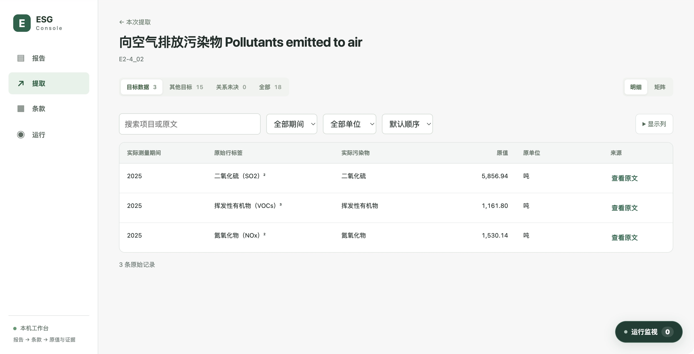
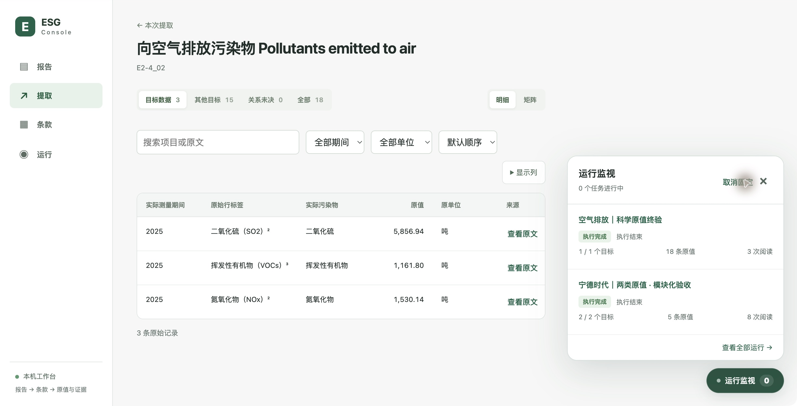

> 日期化基线证据。文内版本、运行ID、路径和“当前/待实施”均指记录当时；旧运行数据与读取适配已按后续要求清除，不提供恢复旧体系的操作。最新实现、37项处置及剩余边界见[10月31日实施](../2026-10-31/README.md)。

# 全链路模块化重大升级与逐条验收

实施：2026-10-30 至 2026-10-31（Asia/Shanghai）。依据：[全盘审查及 F01–F15](../../audits/2026-10-30/README.md)与对应机器证据。

后续复审：本报告的最终18条只涵盖2025；原表另有2023/2024，生产选列仍有截断。接收18/0不证明多年份完整。新增问题与待实施修复见[2026-10-31复审](../../audits/2026-10-31/README.md)，保留本次冻结运行及原验收范围。

本报告区分实现、部署、真实样本效果及尚未证明的泛化能力。主链路已形成 **PDF → 冻结独立条款 → 物理证据 → 两类原值 → 目标关系/组织 → 封存 → 独立数据库接收回执**。原值接收不自动变成比较资格、审核批准或公开发布。

## 1. 本轮最重要的变化

“只有类别、量、单位”可以作为真实原值被接收。主体、子公司、场址、方法、期间、边界和开放分类有位置保存，缺失只影响对应用途的完整度；不能再使正常完成的执行变成 partial。另一方面，化学式、脚注、日期和纯标签不是测量，不能凭有字符来源就进入定量事实。

本轮额外修正了一个真实试跑才暴露的问题：模型会将“其他目标的真实测量”写成 nonmeasurement，或直接省略。现在输出合同禁止不同目标与非测量的矛盾组合；同一候选表中，具有物理行单位、数据行和结构确定期间的明确数值由结构层保留，相关性仍按该条款判定。没有单位证据、期间不明或正文歧义时仍依靠有界模型判断；没有把所有数字放行，也没有写 COD、能源或某条 ESRS 的引擎分支。

## 2. 按 F01–F15 顺序核对

| 编号 | 实施结果 | 本轮证据与边界 |
|---|---|---|
| F01 数字候选与测量 | 已落实。physical literal 类型和模型 selection 分开；SF6/脚注/日期进诊断；真实无单位计数仍可接收 | 正反例回归；最终实跑两条指定伪数字均为0事实；不是只在前端隐藏 |
| F02 执行与质量分离 | 已落实。ResultAssessment分开执行、有限搜索、捕获、属性与比较；失败/取消/中断各自同步 | 最终 completed、18原值、metadata partial、comparison insufficient_context；没有错误时不因集团范围未知而partial |
| F03 条款用途分层 | 已落实。1,126条当前合同1.2拥有capture/enrichment/target/comparison；已知冲突分开，缺失可保留 | 旧1.1冻结形状兼容；比较必需轴唯一写在purposes.comparison，补充轴独立于显示列；37条内容未决仍阻塞 |
| F04 最终诊断 | 已落实。最终字段状态与尝试历史分开，成功绑定清除该轴过时的失败提示 | 最终期间及污染物证据可读；无效可选身份提议不覆盖原值；尝试历史仍保留 |
| F05 结果分区 | 已落实。target / other / unresolved；非测量候选单独查询 | 最终默认空气3条；水体2条和13条同表固废原值在other，共15；非测量另在诊断。没有丢掉真实非目标值 |
| F06 矩阵语义 | 已落实。显示坐标不因stated/inherited重复；一个格显示原值与实际单位 | 实际界面只有一列2025；多事实不求和、不取首值，不把解析字段串成五个值 |
| F07 表格 | 已落实。默认平表、期间/单位/文本过滤、列选择、排序、分页50及原文弹窗 | 浏览器实际核验3条值、COD筛选、矩阵、字段证据；数字不换行；缺单位不称未披露 |
| F08 统一运行窗 | 已落实。Console后端安全MonitorSnapshot；App级收起/展开/固定浮窗、Escape与焦点返回 | 实际窗口与详情同为completed，计数1/1、18原值、3阅读；固定后让出表格空间；旧测试会话从默认列表归档 |
| F09 模型信封 | 已落实。提取、文档ModelRunner、OCR路由、实际布局/识别worker和系统Vision使用共用调用记录 | requested/effective预算、真实模态、尝试、验证等级、tokens和失败；实际Qwen是文字输入grammar_schema，不冒充每次看图；不切云 |
| F10 搜索与物理复用 | 已落实。ClauseESG编译SearchPlan；完整词项、延后字段说明、页/对象/上下文意图 | 最终OCR/IR均reused，模型3次重新阅读；document.search_scope保留17/92页边界，不把有界完成当全报告未披露 |
| F11 模块安装与所有权 | 已落实。独立ClauseESG；轻量contracts/runtime SDK；Console frontend/backend；Plat通过数据库SDK | 四份SDK wheel在仓库外安装，复制Plat消费者与独立数据库资产冷启动成功；不需要完整Extract树。数据库服务部署仍需Node资产/依赖，不将薄SDK冒充完整服务 |
| F12 数据根与目录 | 已落实。ESG_DATA_ROOT集中报告/文档/提取/控制/日志/原值库；手册按architecture/guides/history组织 | 迁移29组、1,817个冻结文件，保留18份原PDF；约990MB明确重复/测试内容移入可恢复废纸篓；11个旧会话归档，原事实按ID仍可读 |
| F13 独立交接与接收 | 已落实。ExportManifest+ZIP+自动outbox+SQL接收与回执 | 最终18接收/0拒收；下载18,966字节重新解码通过；精确numeric；重复、冲突、坏行、断网未知结果和永久拒绝有回归；不读生产者目录 |
| F14 Plat/数据库边界 | 源码与隔离部署已落实。连接、worker、查询、迁移和冻结字典归database；应用启动不迁移 | Plat通过EvidenceResolver读证据接口；旧收据适配隔离；独立冷启动证明。**既有8765发布进程未切换，正式/演示库未迁移**，不能宣称该旧进程已运行新代码 |
| F15 科学基准与成熟度 | 已建立首个可重放真实基准及正反例层，保留内容成熟度边界 | 五条已标注空气/水体原值5/5保留、单位/期间/关系正确；指定两条伪事实0。定性样本有原文及接收验证；**尚无覆盖全部报告/条款的整体精确率或召回率结论** |

F15是持续效果建设的起点，不是“1,126条全部科学验收完成”。当前32条个性化组织示例和技术ready均不等于已发布批准。保护活动库的部署边界不通过重置或迁移来绕过。

## 3. 宁德时代真实新旧对照

原始审查任务：`extract-c8adbfa8d23a8b65e5c8e73aa6c17237`。最终新运行：`extract-1099dd301a241c409a0ab052027c689c`，会话 `extract-plan-51ee4b670cb04ed49dc02b14d834d7ce`。

| 测量 | 2025原值 | 单位 | 最终关系 |
|---|---:|---|---|
| 氮氧化物NOx | 1,530.14 | 吨 | 目标 |
| 二氧化硫SO₂ | 5,856.94 | 吨 | 目标 |
| 挥发性有机物VOCs | 1,161.80 | 吨 | 目标 |
| 化学需氧量COD | 175.61 | 吨 | 其他目标；原值保留 |
| 氨氮 | 20.36 | 吨 | 其他目标；原值保留 |

以上均来自物理PDF第73页，印刷页141–142。最终还保留该候选表内13条其他固废原值，关系为其他目标；不混入默认空气表，不把它们偷偷求和。对五条标注测量的核验见[科学基准结果](scientific-benchmark.json)，额外13条不纳入这一五条基准的准确率统计。

| 指标 | 原任务 | 最终新任务 |
|---|---|---|
| 执行/结果 | partial；7行混合 | completed；18原值，其中3目标、15其他 |
| 化学式/脚注误收 | “6”和“2”进入事实 | 0条进入事实 |
| 属性完整度 | 与执行及映射混合 | partial独立表达 |
| 比较资格 | 隐含在确认状态 | insufficient_context明确表达 |
| 调用 | 5次Qwen | 3次Qwen |
| 提取耗时 | 262.212秒 | 300.549秒 |
| 交接 | 没有新接收器闭环 | 自动封存，18接收、0拒收 |

**最终样本没有比原样本更快，不能写成提速成功。** 调用数减少不代表耗时必然下降；本轮优先解决数值正确、真实测量保留和自动接收。最终运行比最早新试跑更慢，不能挑最快的138.537秒当最终版本成绩。日志分别记录输入/输出tokens和模型耗时，后续以同硬件和同输入的重复测量评估模型成本。

最终准备复用17页物理证据；全PDF共92页。只宣称检索计划范围完成，不据此认定PM/NMHC全报告未披露。集团/实际主体/部分边界仍未知，没有用目标或资源企业猜填。

定性联合试跑 `extract-6efe7c4d3f4791963bcafc684e39c5ac` 实际保存3条定量+2条原文陈述，自动接收5条。它证明定性原文与同一交接链路可用；原文监测/审核描述是否充分回答全部“量化方法”需求仍需独立内容评测，不以文本能绑定就批准为完整科学回答。

## 4. 当前模块与文件布局

```text
ClauseESG/                      单条数据、SDK、Schema、测试
ExtractESG/
  contracts/                    事实、值、资源、运行、交接SDK
  shared_runtime/               调用信封与部署基础SDK
  document/                     PDF物理证据
  extraction/                   单一读取骨干与端口
  pipeline/                     准备/队列/会话协调
ConsoleESG/{frontend,backend}/   操作应用与安全组合层
PlatESG/{frontend,backend}/      已发布数据产品消费者
database/
  src/ runtime/ queries/        接收、连接、查询与受控命令
  migrations/ catalog/          数据模式及冻结产品合同
docs/{architecture,guides,audits,implementation,history}/
.local/data/                    独立业务数据根，不是源码
```

当前规范入口：[模块与接口](../../architecture/README.md)、[原值与组织](../../architecture/organization.md)、[模型](../../architecture/models.md)、[交接](../../architecture/delivery.md)、[运维](../../guides/local-operation.md)。旧实施说明移入history并明确基线，原始升级需求和审查证据保留；没有让多个“当前方案”继续互相矛盾。

一条为完整声明，组只是显示名字，base16/priority32等只是编号选择。新增条款所需词义、范围、补充轴、字典和显示内容均改条款；新增通用能力才扩展SDK/注册算子。条款、报告资源、物理证据、事实格式、目标关系、组织投影、数据库模式独立拥有内容。

## 5. 清理及保留

[清理清单](cleanup.json)记录19组、993,598,675字节移出工作目录，具体恢复位置在本机 `.local/data/control/cleanup-upgrade.json`。被确认的重复冻结副本逐字节比对，明确pytest测试库先查打开句柄；采用系统废纸篓可恢复移动，没有清空废纸篓。

11个已结束的旧测试会话归档，冻结结果仍可按ID读取，API可restore。最终与两类联合样本保留在当前界面。原PDF、现有正式/演示数据库、未知引用的历史备份、CrawlESG和审核凭据不参与清理。不能为了目录整齐删除仍可能被旧发布引用的证据。

## 6. 验证记录

| 类别 | 结果 |
|---|---|
| Python全量整合 | 645通过；最终包含文档、提取、基础运行、条款、Console后端、接收API及Plat。不是把不同轮次计数简单相加 |
| Node数据库及Plat | 99通过、2跳过；初次暴露的旧默认数据根断言已修正并专项通过 |
| Console | 16交互回归；构建通过；实际Chrome核验结果分区、搜索、矩阵、原文、完成及已接收状态、运行窗固定与Escape |
| Plat前端 | 82通过，构建通过；不把构建当活动8765部署证明 |
| 合同 | 1,126条、37阻塞、11份Schema、24个生成模型；冻结旧版本兼容 |
| 独立安装 | 4份SDK wheel隔离安装，仓库外Plat消费者冷启动、权限拒绝及数据库读取通过 |
| 真实导出 | 最终ZIP读取和摘要/两类值解码通过；独立接收18条；发布not_evaluated |

构造反例覆盖中文/英文原文、稀疏与扩展属性、零/范围/强度/破折号、单位在物理表题、真假数字、季度、同轴无效后有效证据、模型/队列错误、取消和原值留存。文档回归另覆盖OCR/IR及有限证据。它们不是新增的多报告人工标注集；不得据此给出全局召回率。

仍可见FastAPI生命周期与测试客户端弃用警告，未伪装为零警告。边界测试和传输验证集中在接收点，没有在每层重新核对同一个值或要求人工批准原值进入下一模块。

## 7. 部署状态、风险与下一步

本轮更新四个生产服务18080/18081/18180/18280，使用独立数据根与新原值库。正式发布8765维持旧进程：源码已退役的入口不能据此宣称旧活动进程消失；其升级应通过既有运维配置执行，保留凭据和数据库，不由本轮读取审核凭据或迁移活动库。

本轮可用范围是本机单协调器、有限检索、独立原值接收；不宣称分布式高可用。当前真实科学基准只覆盖这份报告的标注范围。下一阶段应扩展英文/扫描/复杂多主体的人工标注报告集，并分别评估真实测量、目标相关性、已有属性保留、证据、成本和人工修订量；在这些证据出来前，不提高未验收条款的科学成熟度，也不自动发布原值。

[机器运行与接收证据](verification.json) · [科学五行基准](scientific-benchmark.json) · [独立部署](standalone.json) · [Python回归](python-checks.txt) · [Node回归](node-checks.txt)





## 8. 桌面一键启动追加升级

原桌面入口仍指向不存在的start_local_workbenches.sh，已完整替换，可重复安装的生成器保存在仓库。新入口 → start.sh → workbench.py，共用一个控制器。独立数据根、六个本地模块安装、Console/frontend构建及四服务均适配新目录。

服务后台运行，关闭终端继续执行；重复启动复用同一supervisor。status/stop/restart共用所有权与启动时刻检查；停止拒绝活动提取，观测不确定不当作空闲，外部端口占用不误杀。两个锁防止重复双击产生多套后台。数据库初始化/迁移不在启动流程，Plat8765独立保留，凭据不进入桌面文本。

5项停止安全/进程所有权/桌面入口回归通过，并从实际桌面脚本完成启动、重复复用、停止、再启动与四服务就绪验证。见[桌面启动验收](desktop-launcher.json)。桌面脚本位于 `/Users/choney/Desktop/启动ESG统一工作台.command`，运行和构建结束后可直接双击。
