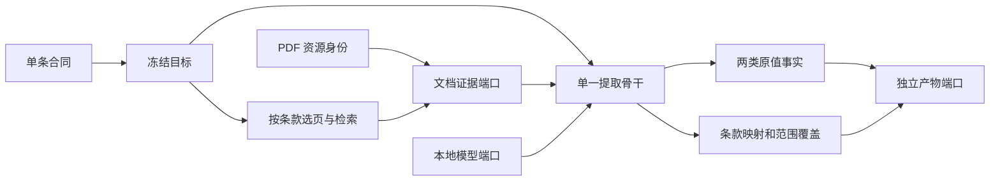

# PDF 到原值事实：模块化重构与逐条核验报告

日期：2026-10-29。本轮依据《全链路检查报告与升级规划.md》及后续修订要求执行。最新范围以“独立条款 + 定量/定性两份合同 + 单一提取骨干 + 报告资源”为准；不重建 Console，不实现新事实的数据库接收器。

本轮已经替换生产后端，而非在旧路线外增加一层包装。旧标准 SDK、包编译/版本入口、foundation/standard 两个生产者、Core 反向事实转换及历史任务适配均退出。**结构迁移通过、真实提取有结果，不代表全部条款已完成科学内容验收。** 当前 1,126 条中有 37 条明确阻塞；其余技术可选状态也不等于真实样本验收。

## 0. 新基线：哪些结果可以核验

- 条款：99 个展示组、1,126 个独立原编号；273 条声明定量，853 条声明定性。37 条阻塞，不可提交提取。
- 选择集合：`base16=16`、`priority32=32`、`quantitative=38`、`universal=34`、`platform_major=55`。这些只是 ID 列表，名称不选择算法。
- 报告资源：当前索引 18 份 PDF；18 份均从已有明确登记资料中带入企业和覆盖年度。发表年份、行业未有声明，保持未知。
- 机器合同：导出条款、定量值、定性值、来源事实、报告资源、批量提交共 6 份 JSON Schema。
- 测试：新骨干与边界 48 项；文档回归 460 项（含过期服务创建入口和资源可用性测试）；PlatESG 冻结消费者 Python 49 项；当前 Node 消费者 35 项。Console 构建通过，保留现有大块脚本体积提示。

测试中的 SQL 库全部是临时隔离库。没有重置、迁移正式库或演示库。测试数量不包含已经退役的旧生产者测试；没有用删除旧测试来宣称其功能仍可用。

## 1. 统一条款科学合同：从“源包唯一”到“生产接口唯一”

### 1.1 一条就是一个完整单位

```text
ExtractESG/standard/
  _catalog.json                 # 可重建索引
  selections.json               # 仅包含条款 ID 列表
  E1-5/
    group.json                  # 组号、名称、成员；无执行逻辑
    E1-5_01/
      clause.json               # 这一条的完整权威定义
```

官方原编号的前导零保留。`E1-4`、`E1-5` 等组不再是编译、运行或版本切换的单位。新增、修改条款不需要进入引擎添加条款 ID 分支。

每条拥有：标签、核心定义、定性/定量类别、区分与排除、单位预期、身份与固定轴、输出范围、检索词典、阅读算子与规则、证据要求、关系和验收样本声明。`reading` 内含该条实际需要的词汇及规则；这些不再由提取 Python 文件另写一份。

核心落点：

- `ExtractESG/contracts/src/esg_clauses/contract.py`：条款科学合同及全内容摘要。
- `parts.py`、`scope.py`：词典、范围、阅读及证据声明。
- `reading.py`、`evidence.py`：条款模块拥有的受控规则解释器。
- `repository.py`：独立读取、编辑、选择和冻结；同一条的并发修改只有一个成功，索引与文件受共同锁保护，写文件采用原子替换。

### 1.2 真实消费而非仅导出文件

| 消费方 | 从条款取得什么 | 不再做什么 |
|---|---|---|
| 编排/选页 | 所选条的词典、类别及摘要 | 固定基础 16 条选页词 |
| 文档检索 | 传入的正负词、精确标签、主题/角色词组、正文/表格优先级 | 读取标准目录或自行定义条款 |
| 模型阅读 | 完整冻结条款及当前物理证据 | 使用代码内条款专属提示词或 spec |
| 匹配确认 | 声明的阅读规则、范围和必需证据 | 把提取到原值直接当成满足条款 |
| 条款 API | 同一个 `clause.json` | 切换聚合包版本和历史包适配 |

标签、排除、关键词、规则、范围、证据等任何合同内容变化都会改变 `clause_digest`。冻结任务携带完整条款内容与摘要；后续编辑不会静默改变已冻结输入。现有条款保存要求 `expected_digest`。编排预览可通过 `expected_target_digest` 绑定后续提交。

`value.comparison_axes`、`aggregation` 等作为条款对未来消费者的声明保留；本轮不执行数据库聚合。`acceptance.samples` 是验收预期，未填样本不会自动生成“已验收”结论。

## 2. 两份原值合同与单一骨干

### 2.1 两种值，不再按路线生成不同事实形状

| 值合同 | 必需值 | 可以待确认或扩展 |
|---|---|---|
| 定量 `QuantitativeValue` | 非空 `value_raw` | 数字解析、严格/非严格比较符、上下界、原单位、扩展注释 |
| 定性 `QualitativeValue` | 非空 `statement_raw` | 原文上下文、扩展注释 |

源文件分别是 `contracts/src/esg_targeted/data_kinds/quantitative.py` 和 `qualitative.py`。定量的绝对量、比例、强度、区间、分项仍属于同一类值，不引入七套互不兼容的主合同。

原值优先：可选数字解析或新元数据不合规时，原文仍进入，原提交信息及问题隔离在 `extensions`。不能把缺失或解析失败变成零。定性值不能混入定量值字段。

共同的 `SourceFact` 位于 `pipeline_contracts.py`，要求文档/IR 身份及可绑定的实际证据；主证据摘录必须等于原值或原文。`value.kind` 仍是已允许的 `quantitative | assertion`。期间、主体、边界、方法及任意补充维度分别保存 `stated / inherited / not_stated / not_read / conflict` 和字段证据。

报告资源的企业是报告身份，不能充当某个数值的实际统计主体；发表年份不能代替测量期间。条款固定轴是目标条件，不能复制为报告事实。

### 2.2 一条骨干、三个端口



`extraction/src/esg_targeted/pipeline/engine.py` 不读取标准目录、不导入包目录仓储、不访问数据库，不含 ESRS 条款 ID。它只消费目标值对象，以及 `DocumentPort / ModelPort / ArtifactPort`。

模型输出来源引用，数值由绑定器从真实单元格或文字位置取回。`decisions.py` 根据当前帧生成引用枚举，模型不能把 `target`、虚构的 `frame` 或报告资源企业 ID 当成物理来源；绑定器还要核对原文。

`binding.py` 先生成独立原值事实，再生成 `ClauseMapping`。分项不符总量、强度不符绝对量、口径不足等结果只影响匹配；已经绑定的原值保留。条款的必需证据由条款 SDK 解释，不能因缺少目标证据而丢弃真实原文。

### 2.3 不复用中立理解结果

每条独立检索与模型阅读；相同证据被两个条款选择时，分别调用模型。再次运行也重新阅读。没有跨条款或跨运行的理解结果缓存。

文档服务仅缓存物理 IR 结构，键覆盖其 JSON 文件签名；证据文件变化不会被缓存遮住。这不保存或复用语义理解。

## 3. PDF、选页、检索与证据绑定

当前入口是文档服务 `POST /api/report-sessions`。输入一个 PDF `asset_id`，加 `clause_keys` 或一个命名选择集合。编排从冻结条款生成显式检索意图，传给文档服务；不传包版本、不让文档服务读取条款目录。

PDF 处理仍采用文字层优先和本地 OCR；云 OCR 没有自动回退。选页结果保持原始 PDF 页码，正文与表格优先级由条款声明。负词用于降低候选排序，避免因同页相邻内容含排除词而删除整页；是否符合定义仍由阅读和映射判断。

跨服务接口只传 IR ID、对象 ID、意图和证据帧：

- `GET /api/evidence/{ir_run_id}`
- `POST /api/evidence/{ir_run_id}/search`
- `POST /api/evidence/{ir_run_id}/read`

提取服务不扫描文档输出目录，也不提交 `bundle_path` 给其他服务。文档服务内部管理自身文件，是模块所有权，不是对外目录接口。

本轮补上的物理绑定检查包括：原文字块的空白和字符偏移、数值单元格原字串、跨页组合表每个单元格的实际页码、真实表头/单位对象 ID、季度和特定期间不冒充年度、报告继承期间不编造第 1 页证据。

找不到候选、预算耗尽、模型截断、证据受限、未确认口径都有独立状态。检索失败不能推导“未披露”。模型失败保留调用诊断及未完成答复，但不从截断 JSON 猜造事实。

## 4. 输出、发布与数据库边界

当前产物为 `extraction-fact-bundle-2.0`：

```text
input/                         # 请求、冻结条款、文档引用、引擎指纹
facts/<source_fact_id>.json     # 每个事实独立存储
results/facts.json             # 事实、条款映射、范围覆盖、摘要
evidence/                     # 实际阅读帧
diagnostics/model-calls.json   # 调用与失败诊断
```

消费者通过提取服务 `/api/runs/{id}/facts` 和 `/api/runs/{id}/facts/{fact_id}` 读取。物理来源锚与本次解释身份分别保存；没有反向 Core 投影。

本轮没有将新格式写入 PlatESG。旧标准包/Core 导入、包合同登记、交付重试和运行时演示造包已退役，不能悄悄恢复旧 SDK 使其继续工作。已有 SQL 审核、发布、版本与公开读产品保留，字典冻结为 1.5.0（55 项）。其字节 SHA-256 为 `c4d73f543d4a20aa604e44c422c7c3a41a50001332f18dbecaa05c1e5173c134`。

运行边界：上述 PlatESG 退役入口已在隔离冷启动测试验证，指当前源码。现有 8765 发布服务没有重启；只读检查仍发现 1 个旧条款编写入口，因此不能宣称该运行进程已经加载新代码。本轮只重启 PDF 文档和提取后端，没有运行会读取审核凭据并初始化数据库的发布启动脚本。

数据库接收器应在独立后续任务中按新合同建设，不把当前试点描述成“已发布入库”。`PLATESG_AUTO_PUBLISH=0`；进程启动只有显式设置为 `1` 才处理发布队列。

## 5. 条款中心接口与内容缺口

当前条款接口已经是按条的读取、创建/修改、选择和冻结；数据修改不要求引擎重启。执行代码或合同类型变化则要求重启，创建/冻结入口有就绪检查，待执行任务核对引擎与文档指纹。

37 个阻塞项保留自己的原编号和明确原因，不回退旧系统：36 项仍混有结构容器、多维表要求或混合披露，尚不能冒充一个定性原文值；`E1-5_19` 的原单位与维度存在冲突。它们需要逐条科学整理及试提取，不可仅改 `readiness` 来消除阻塞。

其余 1,089 条目前是结构可选状态。迁移字典和定义、结构验证、试点样本三者不同；没有为全部条款填造验收样本，也没有声称全部适用于任意报告。

## 6. Console 与状态：本轮遵守的范围

本轮按最新要求没有重构前端。只修正一处 CSS 语法残留；未删除 Console 文件。上轮界面的旧标准、版本和创建表单尚未接入当前 API，因此当前验收入口是两个后端的 `/docs`，不能说 Console 已全部可用。

新编排统一展示 PDF 准备、提取任务、进度、取消和事实链接。底层队列状态、模型 token 进度及条款覆盖是不同事实，不能把生成 token 数当成“已完成多少条款”，也不能把 `partial` 写成可发布。

未来 Console 接入应直接使用单条合同与当前任务 API；不增加旧包版本或历史产物兼容页。

## 7. 新增报告资源模块

`contracts/src/esg_reports` 独立拥有 PDF 资源合同、仓储和目录导入。字段包括 PDF 编号、完整 SHA-256、资源 ID、文件名、企业、发表年份、行业、独立的报告覆盖年度、元数据来源及修订。

一个 PDF 一个单位；可以按企业名称/编号、行业名称/代码、发表年份、覆盖年度筛选。修改元数据带 `expected_revision`。资源快照随 OCR、IR 和最终来源事实传递，测量身份继续独立。

批量目录格式：

```text
batch/
  manifest.json
  pdf/
    report-001.pdf
    report-002.pdf
```

模板与说明在 `ExtractESG/contracts/examples/report-batch/`。新批次必须声明企业、发表年份和行业，逐文件匹配完整散列；先校验整批，再复制登记。重复提交幂等，编号/内容冲突明确拒绝，失败回滚本次新增文件。入口是 `/api/report-resources/imports`，默认预览。

资源列表默认只列实际可访问的 PDF，以 `asset_available` 区分文件与暂存元数据。修复了 OCR 回归测试未隔离资源库的问题，并清除了 14 条确认不属于实际报告库的虚拟输入元数据；再次执行 13 项文字层/OCR 回归后真实资源库仍为 18 条，隔离有效。原始 PDF 没有增删。现有 18 份 PDF 的行业与发表年份没有可靠声明，未根据文件名或覆盖年度猜填。接口能力已经建设，元数据补齐仍需真实来源。

## 8. 清理清单与保留范围

已删除：旧标准源码/编译包/注册表/版本目录/兼容链接；旧 foundation 与 standard 生产者；旧任务模型、结果转换、会话提升和历史适配；失效脚本、对应生产者测试、说明文档及保存的旧源码副本；旧任务、OCR/IR、检查点和提取衍生产物；外部旧 `标准要求包/`。

第一轮运行清理统计：12,377 个文件、2,456,170,204 字节，清除 3,851 行旧任务/事件记录。报告身份三张表保留。本轮中间试跑另清理 39 处产物路径、311,472,444 字节和 903 行任务/事件/引用记录，只保留最终核验运行及其依赖。

原始 PDF、明确登记的报告身份、PlatESG 正式/演示数据库保留。`CrawlESG/` 没有修改或暂存；其原有工作区删除不进入本轮提交。没有读取或复制审核凭据文件。

## 9. 真实运行与逐项结果

以下是已经完成的真实核验。5 个独立事实接口均逐条回读，并与保存的 IR 原值／原文字符区间逐项一致；试跑时引擎指纹与执行源码一致；提交前仅清理了五个文件的行末空白，AST 比对一致。机器记录见 [verification/2026-10-29-backbone.json](docs/verification/2026-10-29-backbone.json)。

| 项目 | 实际结果 |
|---|---|
| PDF | 宁德时代 2025 年 ESG 报告，`pdf-7ef566e38b68b8d96ef6369c` |
| 编排运行 | `extract-plan-96150bc0b371431d94915a21e6707886` |
| 提取运行 | `extract-d2fa21ef8a55d52ec2a2b94a66caaada` |
| IR | `ir-20261029T145541Z-9f3c462a2ed5`，原始 PDF 页码保留 |
| 所选条款 | `E1-5_01`、`E1-1_01`，各独立检索、阅读 |
| 模型 | 本地 Qwen3.5-9B-4bit；2 次调用；无云切换 |
| 提取耗时 | 125.901 秒（不包含前面的 PDF 准备） |
| 产物 | 4 条定量、1 条定性；调用/合同错误 0 |
| 综合能源原值 | `24,767,519.69`，原单位“兆瓦时”，2025 表头，PDF 第 72 页 |
| 错配保护 | 直接/间接能源分项、能源强度原值保留，但与总量条款的映射为 `different` |
| 定性原文 | PDF 第 6 页的低碳转型陈述，保留原文与上下文；不等于完整转型计划 |
| 覆盖结论 | 两条均为 `unconfirmed`，任务为 `partial`；没有入库或发布 |

总量的物理来源为 `cell-p0072-t0003-r0003-c0005`，期间证据为实际“2025”表头单元格。模型尝试从目标/资源推断的企业和边界没有被当作实际测量身份。部分文档证据仍有限，定性摘录也缺少完整计划要素；这正是保留待确认结论的原因。

最终产物接口：`http://127.0.0.1:18180/api/runs/extract-d2fa21ef8a55d52ec2a2b94a66caaada/facts`。数据文件由提取模块保管，不要求消费者拼接输出目录。

| 用户逐项要求 | 核对结果 |
|---|---|
| 条款信息真正内聚 | 已替换为独立 `clause.json` 和 SDK；词典/阅读规则由生产路径实际消费 |
| 大组只是展示外套 | `group.json` 无提取策略；集合只是 ID 列表 |
| 定量与定性两份合同 | 已统一原值合同；未知元数据可扩展，错误可隔离 |
| 一条骨干，清除两路事后适配 | 已替换；不再输出 Core 再反推事实 |
| 从所选条款拿词典选页/搜索 | 已接通 PDF 编排、选页、对象检索和模型上下文 |
| 不复用中立理解 | 已取消跨条款、跨运行模型阅读缓存；回归测试验证每次独立调用 |
| 原文、匹配、范围分离 | 已实现；错配原值保留，条款匹配单独降级 |
| 报告资源独立并贯穿 | 已实现身份、筛选、元数据修订和目录批量导入；未知信息未猜填 |
| 旧版本、旧任务、失效文档清理 | 已执行；最终仅保留本轮最终核验运行及文档依赖 |
| 前端暂不重构 | 已遵守；旧表单尚未接新接口，不能称为完整可用 |
| 数据入库本轮不讨论 | 未接新接收器、未发布、未迁移现有数据库 |
| 所有条款科学内容均可直接投产 | 尚未达到；37 条阻塞，其余也需要实际样本验收 |


## 10. 后续仍需处理的内容

1. 逐条整理 37 个阻塞项，并为需要正式使用的条款建设多报告验收样本；索引通过不能替代这一步。
2. 根据实际报告补齐资源行业、发表年份，保留声明来源；资源企业继续不代替事实主体。
3. 本轮未接的 Console 新表单与新事实数据库接收器分别建设，直接消费当前接口；不恢复旧生产者。
4. 真实试点的条款覆盖若仍是 `unconfirmed`，继续补足实际边界、主体、方法或目标完整性证据；不得用默认口径把它改成通过。

## 附录：37 个阻塞条款逐条登记

| 原编号 | 名称 | 阻塞原因 |
|---|---|---|
| `BP-2_07` | 高测量不确定性指标 | 原条目为混合披露或结构要求，须明确值级数据种类和证据合同后启用。 |
| `BP-2_14` | 前期差错更正 | 原条目为混合披露或结构要求，须明确值级数据种类和证据合同后启用。 |
| `BP-2_24` | 阶段安排的期限目标及进展 | 原条目为混合披露或结构要求，须明确值级数据种类和证据合同后启用。 |
| `BP-2_27` | 阶段安排的指标 | 原条目为混合披露或结构要求，须明确值级数据种类和证据合同后启用。 |
| `E1-3_06` | 重大资本和运营支出与财务报表关联 | 原条目为混合披露或结构要求，须明确值级数据种类和证据合同后启用。 |
| `E1-4_02` | 排放目标的多维披露结构 | 原条目为混合披露或结构要求，须明确值级数据种类和证据合同后启用。 |
| `E1-5_19` | 高气候影响行业能源消费总量 | 原科学合同未声明可用规范单位，且单位维度与元素绑定不一致；须修订该条后试提取。 |
| `E1-6_01` | 范围1、2、3及温室气体排放总量的披露结构 | 原条目为混合披露或结构要求，须明确值级数据种类和证据合同后启用。 |
| `E1-6_02` | 财务控制与运营控制边界表 | 原条目为混合披露或结构要求，须明确值级数据种类和证据合同后启用。 |
| `E1-6_03` | 温室气体排放分解维度 | 原条目为混合披露或结构要求，须明确值级数据种类和证据合同后启用。 |
| `E1-6_04` | 采用《温室气体核算体系》的范围3类别结构 | 原条目为混合披露或结构要求，须明确值级数据种类和证据合同后启用。 |
| `E1-6_05` | 采用 ISO 14064-1 的范围3类别结构 | 原条目为混合披露或结构要求，须明确值级数据种类和证据合同后启用。 |
| `E1-6_06` | 范围3价值链分解结构 | 原条目为混合披露或结构要求，须明确值级数据种类和证据合同后启用。 |
| `E1-7_04` | 移除储存活动的披露结构 | 原条目为混合披露或结构要求，须明确值级数据种类和证据合同后启用。 |
| `E1-8_01` | 内部碳定价机制的披露结构 | 原条目为混合披露或结构要求，须明确值级数据种类和证据合同后启用。 |
| `E1-9_38` | 转型风险业务预期利润侵蚀 | 原条目为混合披露或结构要求，须明确值级数据种类和证据合同后启用。 |
| `E2-4_01` | 空气、水和土壤污染披露维度结构 | 原条目为混合披露或结构要求，须明确值级数据种类和证据合同后启用。 |
| `E2-4_18` | 实际环境绩效与 BAT-AEL 比较 | 原条目为混合披露或结构要求，须明确值级数据种类和证据合同后启用。 |
| `E2-4_19` | 实际环境绩效与 BAT-AEPL 比较 | 原条目为混合披露或结构要求，须明确值级数据种类和证据合同后启用。 |
| `E2-5_01` | 关注物质按危害类别分解的披露结构 | 原条目为混合披露或结构要求，须明确值级数据种类和证据合同后启用。 |
| `E4-6_06` | 财务金额的估计方法与关键假设 | 原条目为混合披露或结构要求，须明确值级数据种类和证据合同后启用。 |
| `G1-4_03` | Prevention and detection of corruption or bribery - anti-corruption and bribery training table | 原条目为混合披露或结构要求，须明确值级数据种类和证据合同后启用。 |
| `G1-5_08` | 财务与实物政治捐赠表 | 原条目为混合披露或结构要求，须明确值级数据种类和证据合同后启用。 |
| `IRO-1_14` | 识别评估输入参数 | 原条目为混合披露或结构要求，须明确值级数据种类和证据合同后启用。 |
| `MDR-T_02` | 可量化目标 | 原条目为混合披露或结构要求，须明确值级数据种类和证据合同后启用。 |
| `MDR-T_18` | 效果评估的预期水平与指标 | 原条目为混合披露或结构要求，须明确值级数据种类和证据合同后启用。 |
| `S1-10_02` | 员工工资低于适用足额工资基准的国家表 | 原条目为混合披露或结构要求，须明确值级数据种类和证据合同后启用。 |
| `S1-11_06` | 按国家、事件类型与员工类型划分的社保覆盖表 | 原条目为混合披露或结构要求，须明确值级数据种类和证据合同后启用。 |
| `S1-13_01` | Training and skills development indicators gender [table] | 原条目为混合披露或结构要求，须明确值级数据种类和证据合同后启用。 |
| `S1-17_01` | 按类型划分的歧视事件数量（表） | 原条目为混合披露或结构要求，须明确值级数据种类和证据合同后启用。 |
| `S1-6_01` | Characteristics of undertaking's employees - number of employees by gender [table] | 原条目为混合披露或结构要求，须明确值级数据种类和证据合同后启用。 |
| `S1-6_04` | Characteristics of undertaking's employees - number of employees in countries with 50 or more employees representing at least 10% of total number of employees [table] | 原条目为混合披露或结构要求，须明确值级数据种类和证据合同后启用。 |
| `S1-6_07` | Characteristics of undertaking's employees - information on employees by contract type and gender  [table] | 原条目为混合披露或结构要求，须明确值级数据种类和证据合同后启用。 |
| `S1-6_08` | Characteristics of undertaking's employees - information on employees by region [table] | 原条目为混合披露或结构要求，须明确值级数据种类和证据合同后启用。 |
| `S1-6_18` | Further detailed breakdown by gender and by region [table] | 原条目为混合披露或结构要求，须明确值级数据种类和证据合同后启用。 |
| `SBM-3_08` | 当前财务影响及资产负债调整风险 | 原条目为混合披露或结构要求，须明确值级数据种类和证据合同后启用。 |
| `SBM-3_09` | 短中长期预期财务影响 | 原条目为混合披露或结构要求，须明确值级数据种类和证据合同后启用。 |
